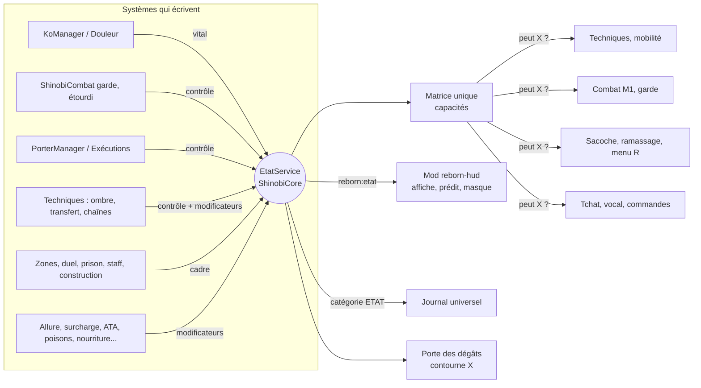
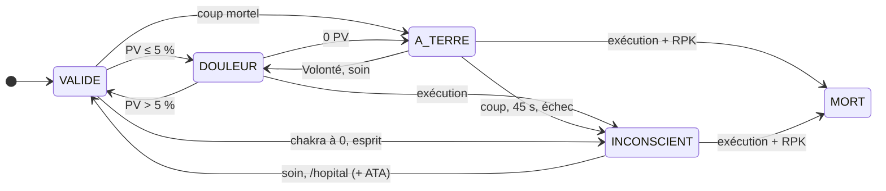
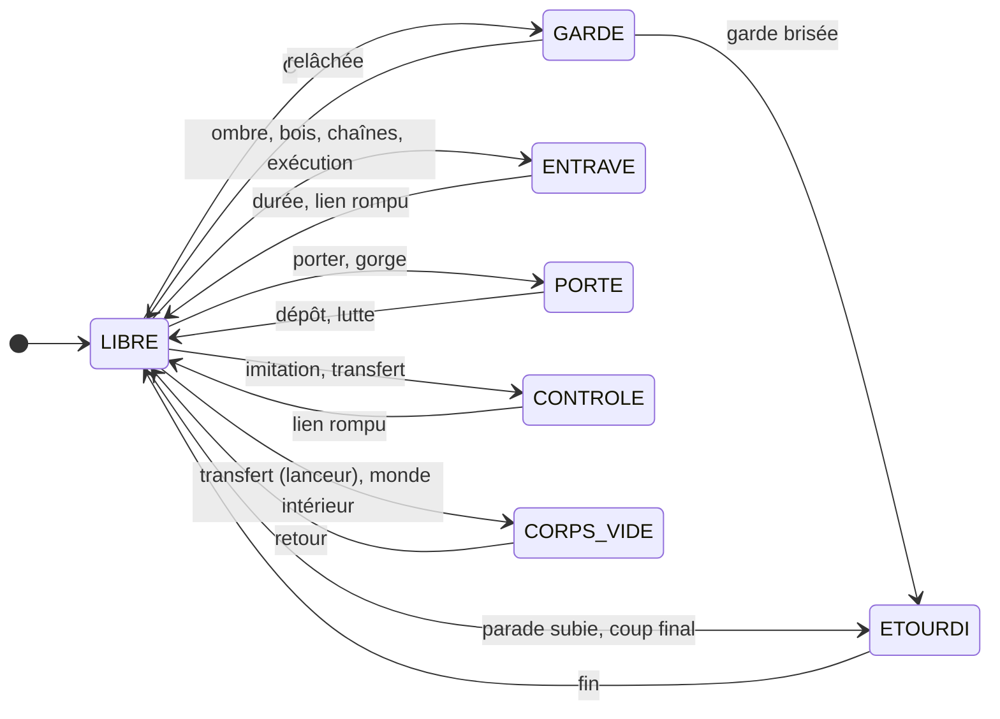

# États du joueur — étude et conception

> **Fiche technique de conception, 2026-10-14.** Statut : **principe validé le 14/10** (« ok pour les états… il faut
> structurer correctement les choses et prendre toutes les possibilités des clans et autres ») ; **le code vient après
> le chantier nourriture** (GAMEPLAN §12), qui doit d'ailleurs créer le registre des modificateurs décrit ici (§4.4).
> **Toutes les recommandations ont été validées le 14/10** (§11, avec les variantes de l'utilisateur) et **l'étape 0
> (correctifs urgents) est codée** le 14/10 (§9, « Étape 0 faite ») ; le reste (service, couches, matrice) n'est pas codé.
>
> Sources : [`../GAMEPLAN.md`](../GAMEPLAN.md) §1.5 (états validés le 13/10), §13 (Player State System), §34 (Logia →
> équivalents chakra) ; fiches [`../gameplay/KO_ET_MORT_RP.md`](../gameplay/KO_ET_MORT_RP.md),
> [`DEPLACEMENTS.md`](../gameplay/DEPLACEMENTS.md), [`INVENTAIRE_ET_COSMETIQUES.md`](../gameplay/INVENTAIRE_ET_COSMETIQUES.md),
> [`APPRENTISSAGE.md`](../gameplay/APPRENTISSAGE.md), [`PERSONNAGES.md`](../gameplay/PERSONNAGES.md),
> [`STATS_ET_PROGRESSION.md`](../gameplay/STATS_ET_PROGRESSION.md) ; [`PLUGINS_REFERENCE.md`](./PLUGINS_REFERENCE.md) ;
> RedLine *Character State System*, *Player State System* et *FDD & Logia* (concepts repris, jamais le texte) ;
> benchmarks `../etudes/benchmark-2026-10/` (Ninshu, Nydo) ; **audit du code en lecture seule** le 14/10 (ShinobiCore,
> ShinobiAbilities, ShinobiCombat, ShinobiTail, ShinobiSense, ShinobiLearning, RebornGuardian, RebornOst, mod
> `reborn-hud`).

---

## Sommaire

1. Le principe en une phrase, le vocabulaire
2. L'existant : tous les états et drapeaux du code, et leurs incohérences
3. Inventaire Naruto : clans, kekkei genkai, techniques et objets qui créent un état
4. Le modèle cible : trois couches, état principal, modificateurs, capacités, matrice
5. Les transitions
6. « Contourne X » : défenses absolues et attaques qui passent outre
7. Autorité, synchronisation, persistance, journal, effets physiques
8. L'API
9. Migration, étape par étape, fichier par fichier
10. Jeux de tests
11. Points à trancher

---

## 1. Le principe en une phrase

**Chaque personnage a, à tout instant, un état tenu par le serveur seul, que tous les systèmes interrogent avant
d'agir par une seule question — « peut-il faire X ? » — dont la réponse vient d'une matrice unique.**

| Mot | Sens |
|---|---|
| **Couche** | Une des trois questions indépendantes sur le personnage : son **corps** (Vital), **qui le pilote** (Contrôle), **les règles du lieu** (Cadre). Une seule valeur par couche à la fois. |
| **État principal** | La valeur unique qu'on affiche et qu'on journalise (Libre, Combat, Douleur, À terre, Porté…), **résolue** à partir des couches par une échelle de priorité. Les 8 états validés le 13/10 en font partie. |
| **Modificateur** | Un effet daté, cumulable, posé par une source (ATA, poison, menottes, pilule, mode ermite, surcharge…). Même objet que « l'effet générique » de la nourriture. |
| **Capacité** | Une question fermée (`BOUGER`, `TECHNIQUE(nin)`, `OUVRIR_SACOCHE`, `CIBLABLE`…), **calculée**, jamais stockée. |
| **Étiquette** | Une propriété d'une attaque (`RAITON`, `PHYSIQUE`, `ANTI_CHAKRA`…) confrontée aux défenses de la cible : c'est le « contourne X » de RedLine. |

---

## 2. L'existant (audit du 14/10)

### 2.1 Le constat

- **≈ 70 états ou drapeaux** côté serveur qui changent ce qu'un joueur peut faire, répartis dans **une trentaine de
  classes** de six plugins, plus **≈ 20 drapeaux** côté mod. Chacun est une `Map`/`Set` en mémoire d'un gestionnaire, un
  fichier YAML, un champ du personnage, une **potion vanilla**, un **modificateur d'attribut** ou un **drapeau vanilla**
  (`Invulnerable`, gamemode, pose, `walkSpeed`, `allowFlight`). Aucune métadonnée ni PDC joueur.
- **Aucun lecteur commun.** Le seul point partagé est `KoService.isImpaired` (= ATA **ou** douleur), lu par
  ShinobiAbilities et ShinobiCombat ; tout le reste se vérifie au cas par cas, avec des oublis.
- **Il n'existe aucun état « combat »** (pas de minuteur de combat commun) ; la garde et l'étourdi vivent dans
  ShinobiCombat, l'étourdi n'empêche ni M1, ni garde, ni technique ; la garde n'est imposée (immobilité) que par le mod.
- **En KO, le mod ne bloque aucune entrée** : le serveur refuse, mais pas partout (voir n° 1 à 3 ci-dessous).

### 2.2 Inventaire serveur

Abréviations : **Core** = ShinobiCore, **Abl** = ShinobiAbilities, **Cmb** = ShinobiCombat, **Tail**, **Sense**.
Persistance : **Y** = fichier YAML, **P** = champ du personnage, **M** = mémoire seulement, **N** = laisse une trace en NBT
(potion, `Invulnerable`, gamemode) qui survit à un crash.

**a) Chaîne KO, corps, mort RP** — devient la couche **Vital** + `PORTE` / `ENTRAVE` + modificateurs `ATA`, `OCCUPE`

| État | Stockage | Écrit par | Lu par | Ce qu'il bloque / fait | Persist. | Client |
|---|---|---|---|---|---|---|
| Douleur (PV ≤ 5 %) | `ko/DouleurManager` `inPain` (dérivé des PV) | tick 5 t, dégâts, soins | `KoManager.isImpaired`, `PorterManager`, `CorpsService` | vitesse ×0,6 (`shinobicore:ko_douleur`), faim tenue à 6, pas de sprint, aucun coup (LOW) ; lâche ce qu'on porte | dérivé | `reborn:corps` `me.d`, `dl`, `ko_event` 8 |
| À terre (agonie 45 s) | `ko/KoManager` `active` → `KoState.phase=DOWNED` | `KoListener.triggerKo` | ≈ 25 classes | ramper (pose nage, lenteur II, pas de saut), commandes en liste blanche, chuchoter 4 blocs | Y `ko-state.yml` (minuteur **réel**, court hors ligne) | `reborn:ko` |
| Inconscient (HP / chakra) | `KoState.phase=UNCONSCIOUS`, `cause` | `KoManager` (coup, temps, Volonté ratée, exécution), scan chakra, `ExhaustionManager` | idem | figé (téléporté sur place), pose sommeil, lenteur VII, obscurité ; `/hopital` après 5 min ; cause chakra : réveil auto 3 min | Y | `reborn:ko` |
| Volonté (QTE, relèves, second souffle) | `ko/VolonteQte` `runs`, `releves`, `secondWind` | canal `reborn:volonte` | `KoManager.enterKo` | prolonge l'agonie ; 2 relèves max | **M** (perdu au redémarrage) | `reborn:volonte` |
| ATA pleine / allégée | `ko/ata/AtaManager` `states` (par **personnage**) | `KoManager.wake`, staff | `isImpaired`, `DuelService`, Poste de garde | pas de trot ni sprint ni mobilité ni technique ; M1 mains nues ×0,5 (**HIGHEST, après le KO**) ; lenteur I | Y `ata-state.yml` | `reborn:ko` (`ata`, repos) |
| Porté / porteur | `ko/action/PorterManager` `byCarrier`, `byCarried`, `struggle` | `/corps porter` | `InventoryManager.lockReason`, `CorpsService`, `VolonteQte` | passager ; porteur : lenteur II **infinie** ; lutte à l'Espace (douleur) | M, **N** (lenteur infinie) | `reborn:corps` `me.c`, `me.s` |
| Tenu à la gorge | `CorpsService` `held` | `/corps gorge` | `isHeld` | victime téléportée devant chaque tick ; tenant : lenteur III **infinie** | M, **N** | `reborn:corps` |
| Exécution en cours | `CorpsService` `running` | `/corps executer` (touche F) | — | deux joueurs figés (téléport), lenteur VI | M | `reborn:corps` `me.x` |
| Scène de mort | `ko/action/DeathScene` `scenes` | `KillRequestManager.kill` | `InventoryManager`, `CorpsService` | `Invulnerable`, figé, muet, aucune commande sauf `/corps quitter` | M (+ `dead` sur P), **N** | `reborn:corps` `mort` / `fin` |
| RPK demandé / accordé | `KillRequestManager` `pending` | menu R, staff | `CorpsService` | permet l'exécution mortelle | M | `reborn:corps` `rpk` |
| Épuisement de chakra (dette) | `chakra/ExhaustionManager` `deficitSeconds` | dette du `ChakraPool` | personne (`isExhausted` jamais lu) | lenteur, faiblesse, fatigue, nausée, cécité ; puis KO | M | — |

**b) Cadre : lieux, duel, staff, écrans** — devient la couche **Cadre** et les modificateurs staff

| État | Stockage | Écrit par | Ce qu'il fait | Persist. | Client |
|---|---|---|---|---|---|
| Terrain d'entraînement | `ko/zone/TrainingZones` (`training-zones.yml`, instantanés M) | entrée / sortie | 0 PV = défaite (lenteur IV + cécité), PV et chakra rendus à la sortie | position | — |
| Zone de repos | idem | — | fait avancer le repos ATA (assis / allongé) | position | — |
| Duel (invitation, décompte, combat, grâce 3 s) | `duel/DuelService` `duels`, `invites`, `grace` | `/duel`, menu R | 0 PV = défaite, PV d'avant rendus ; tiers qui frappe = annulé ; technique refusée par `techniqueDenial` (**seul lecteur : le lancer de technique**) | M | `reborn:duel` |
| Mode construction | `staff/StaffBuildManager` `building` | staff | créatif, sacoche mise de côté ; sort au KO, au changement de perso | M, **N** (créatif après crash) | — |
| Mode staff | `staff/outils/ModeStaff` `actifs` | `/modestaff` | invisible, vol, `Invulnerable`, pas de collision ; ni coup, ni dégât, ni ramassage | M, **N** | `reborn:plaques` |
| Sélection de personnage | `character/select/CharacterSelectManager` `selecting` | `reborn:character "open"` (**accepté dans n'importe quel état**) | téléporte à l'ancre, `Invulnerable`, caché de tous | M, **N** | `reborn:character` |
| Verrou sans personnage | `character/NoCharacterLockdown` `locked` | JOIN sans personnage | cécité, lenteur VI, saut ×128, fatigue (1 h, rafraîchies) | M | — |
| Cinématique | `cinematic/CinematicPlayback` `sessions` | staff, intro | `Invulnerable`, invisible, `walkSpeed 0`, figé ; **immunise contre le KO** | M, **N** | — |
| Authentification en attente | Guardian `AuthSessionState` (8 s) | JOIN | **ne restreint rien** pendant 8 s | M | — |

**c) Outils staff** — deviennent des modificateurs `STAFF` attachés au **compte**

| État | Stockage | Ce qu'il fait | Persist. | Lu par les systèmes de jeu ? |
|---|---|---|---|---|
| Gel | `staff/outils/Gels` (`gels.yml`) | figé (sauf chute), ni coup, ni interaction, ni lâcher ; tchat et commandes libres | Y | **non** : on peut porter un gelé, le geler n'empêche ni `/corps`, ni `/duel`, ni la sélection de personnage (qui le téléporte = **évasion**) |
| Vanish | `vanish/VanishManager` | `hide/showEntity` seulement | M (survit à la déco via le mode staff, bogue) | **non** : un invisible frappe, est frappé, porté, mis KO, apparaît dans la liste des corps et l'indicateur de frappe ; le Byakugan le révèle |
| Écran noir | `staff/outils/EffetsStaff` `noirs` | mod : écran noir ; sans mod : cécité + obscurité **infinies** | M, **N** | — |
| Tenue forcée | `staff/outils/TenuesForcees` (`tenues-forcees.yml`, par perso) | verrouille l'emplacement Tenue | Y | sacoche |
| Muet | `staff/panel/StaffStore.mutedUntil` (`sanctions.yml`) | bloque le tchat seulement (pas `/me`) | Y | — |

**d) Combat (ShinobiCombat)** — devient `GARDE`, `ETOURDI` (couche Contrôle) et `EN_COMBAT`

| État | Stockage | Ce qu'il fait | Manque |
|---|---|---|---|
| Garde | `combat/CombatListener` `blocking` | −70 % des dégâts, −25 d'endurance par coup, M1 de l'attaquant annulé, tout sort MagicSpells annulé | vérifie seulement « personnage + pas KO » ; pas de verrou après garde brisée ; **non nettoyée au KO** ; l'immobilité n'est imposée que par le mod |
| Parade (320 ms) | `blockStartMs` | coup annulé, attaquant étourdi 16 t | — |
| Étourdi | `stunnedUntil` (fournit `StunService`) | lenteur VII ; sacoche en lecture, ramassage refusé, sprint refusé | **n'empêche ni M1, ni garde, ni dash, ni technique, ni mobilité** ; jamais nettoyé |
| Endurance, essoufflé | `StaminaManager` (par **joueur**) | coûts M1, garde, sprint, dash | jamais remise à zéro au changement de personnage |
| Mouvements de combat (dash, esquive, saut de chakra, keriox) | dates de recharge | vitesses bornées par le serveur | vérifient seulement KO et surcharge (ni ATA, ni étourdi, ni voie, ni déblocage) |
| « En combat » | **n'existe pas** | — | le Game Plan en fait un état (§1.5) |

**e) Mobilité (ShinobiAbilities, Core)** — devient capacités `MOBILITE(type)` + modificateurs de confort

| État | Stockage | Gardes actuelles | Trous |
|---|---|---|---|
| Voie (aucune / Chakra / Flux), emplacements débloqués | `MobilityPaths` (`mobility-paths.yml`), `ToggleStore` (`mobility-unlocks.yml`) | — | — |
| Allures (marche, trot, sprint), essoufflé | `mobility/Allure` | sprint : ni ATA, ni étourdi, ni Chargé, ni porteur | le trot ne regarde rien ; ne prend pas en compte la vitesse du bijū (prédiction faussée) |
| Course ninja | `NarutoRun` `active` | KO, ATA, surcharge, chakra | pas l'étourdi ; s'arrête sur le seul `KoEnterEvent` |
| Voie du Flux (élan, glissade, vol) | `MobilityPathTwoModule` | KO, ATA, surcharge, eau | ni étourdi, ni sélecteur, ni grappin |
| Double saut, saut mural, escalade, dash, onde au sol | `DoubleJump`, `WallJump`, `Climb`, `ShinobiDash`, `FloorShockwave`, `AirTokenManager` | `groundGame` (KO, ATA, voie) + surcharge + sélecteur + mini-jeu | aucun ne regarde l'étourdi ; l'onde au sol **étourdit par potions** hors `StunService` et touche tout le monde (KO, invisibles, faux corps) |
| Tyrolienne de sentier | `TrailManager` | KO, ATA | les dégâts ne l'arrêtent pas |
| **Grappin, tyrolienne (Core)** | `mobility/*` | permission, recharge, chakra | **aucun état** et écouteurs en `HIGHEST ignoreCancelled=false` : passent à travers KO, gel, scène de mort, cinématique |
| Parcours d'entraînement | `training/ParkourRunner` | **aucune** | `/trainingground run` téléporte : **évasion** possible en combat ou gelé |
| Éditeurs (sentier, parcours) | barre d'objets mise de côté **en mémoire** | — | perdue au crash |

**f) Techniques, apprentissage, médical** — devient `OCCUPE`, capacités `TECHNIQUE(type)`, modificateurs

| État | Stockage | Gardes actuelles | Trous |
|---|---|---|---|
| Sélecteur de techniques (barre échangée) | `jutsu/JutsuHotbarManager` (barre réelle en mémoire) | personnage, pas KO | perdue au crash ; pas d'étourdi / ATA / garde |
| Incantation (mudras) | `jutsu/IncantationManager` | aucune revérification au moment du lancer | les dégâts, l'étourdi, la garde ne l'interrompent pas |
| Lancer de technique | `JutsuExecutionManager.gateOrWarn` | personnage, KO, ATA / douleur, duel, arme, appris, recharge, coût | pas l'étourdi, la garde, la transformation, le monde intérieur, le genjutsu, le gamemode, l'invisibilité, le mode staff ; recharges rangées par **compte** |
| Séance, mini-jeux (mudras, pompes, suivi), concentration | `SeanceService.training`, `LearningMinigame`, `ConcentrationGame` | KO au départ | pas d'arrêt au KO ni au changement de perso ; une séance « suivi » bloque les techniques **sans limite** ; fuite à la déco |
| Vol de parchemin (fouille immobile) | `parchemin/VolService` | — | pas de KO, étourdi, combat |
| Méditation | `character/MeditationManager` | — | pas de KO, douleur, duel, gel ; continue pendant un KO par le chakra |
| Postures (assis, allongé, ramper), siège | `sit/PostureManager`, `SitListener` | KO, véhicule | — |
| Paume de soin, traitement | `medic/PalmHealing`, `TreatmentApplier` | médic pas KO | pas de douleur, gel, mort |
| Cécité (yeux) | personnage (`yeux.*`) | — | côté client seulement, contournable (mode photo, F1) |
| Chirurgie des yeux | `YeuxCommand.jetons` | — | **le client décide du résultat** |

**g) Démons à queues, perception** — deviennent `MODE_BIJU`, `CORPS_VIDE`, `SOUS_ILLUSION`, `DOJUTSU_ACTIF`

| État | Stockage | Ce qu'il fait | Trous |
|---|---|---|---|
| Transformation (stade, rage, union, libération finale) | `Tail/transform/TransformationManager` (M ; rage en Y) | dégâts, vitesse, résistance ≤ 80 %, recul, **taille**, régénérations ; potions de stade **infinies** ; stade 9 = mort du personnage | pas de garde duel / staff / zone ; `/tail union` sans KO ; potions infinies survivent au crash |
| Monde intérieur + faux corps | `Tail/inner/InnerWorldManager`, `FakeBody` | hôte figé, **`Invulnerable`**, téléporté ailleurs, faux corps au sol | n'empêche ni technique, ni sélecteur, ni tchat ; à la sortie **retire toute lenteur et cécité**, d'où qu'elles viennent ; `Invulnerable` en NBT au crash |
| Genjutsu subi | `Sense/GenjutsuManager` | nausée, cécité et lenteur aléatoires, murmures ; Kai | **personne ne lit l'état** ; Kai retire toute lenteur / cécité / nausée (y compris l'étourdi de combat) ; aucune garde au lancer |
| Dōjutsu actif, vision Byakugan | `DojutsuManager`, `ByakuganVision` | 8 chakra/s, perception ; vue à travers les murs | pas de KO / étourdi ; **révèle les staffs invisibles** |
| Chakra masqué | `SenseService.suppressed` (par compte) | caché des senseurs | survit au changement de perso |

**h) Inventaire** — devient modificateur `SURCHARGE` + capacités `SACOCHE` / `RAMASSER`

| État | Stockage | Ce qu'il fait | Trous |
|---|---|---|---|
| Paliers de poids (Chargé, Surchargé, Immobile) | `inventory/Surcharge` | vitesse 0,9 → 0 et saut (`reborn:surcharge`), sprint coupé | seuil lu différemment (`≥ SURCHARGE` ici, `≥ CHARGE` pour l'allure) ; Immobile non imposé côté client |
| Sacoche en lecture seule | `InventoryManager.lockReason` | mort, KO, porté, étourdi | **ni gel, ni mode staff, ni cinématique, ni prise à la gorge** ; le lâcher par la sacoche contourne les blocages de lâcher |
| Arme dégainée | PDC objet `reborn:degainee` | techniques de Kenjutsu | — |

**i) Effets de techniques et d'objets** (détail au §3.1) : feu, lenteurs (« racines »), cécité, nausée, poison,
faiblesse, fatigue, surbrillance, vitesse, contrecoup, pilule du soldat. Tous en **potions vanilla** sur **toute entité de
la zone** (alliés, KO, invisibles et faux corps compris), aucun ne passe par `StunService`.

### 2.3 Côté mod (`reborn-hud`)

| Drapeau | Canal | Ce qu'il fait | Problème |
|---|---|---|---|
| `KoClient.state` | `reborn:ko` | filtre, sons, caméra, HUD masqué (`KoMasqueHud`) | **ne bloque aucune entrée** ; pas de champ « douleur » (vient de `reborn:corps`) |
| `CorpsClient.douleur/porte/lutte/exe` | `reborn:corps` | invites, menu R grisé | « porté » existe aussi par `isPassenger()` |
| `CombatInput.blocking` | — (local) | immobilise, coupe saut et clic | **seule** imposition de l'immobilité en garde |
| `Allure` | `reborn:allure` | pose la vitesse (prédiction) | ne connaît pas le KO ; la vitesse du bijū la fausse |
| `NotifClient.poids` | `reborn:notif` | coupe le sprint dès Chargé | le palier Immobile n'est pas appliqué |
| `CeciteHud`, écran noir staff, KO | `reborn:yeux`, `reborn:ecran` | voiles plein écran | **contournables** par le mode photo et F1 (le HUD entier est annulé) |
| `DeathScreen` | `reborn:corps` | caméra, HUD caché | pas de `removed()` : un écran ouvert par-dessus laisse le HUD caché **d'une session à l'autre** |
| `InteractionMode` | — | capture la souris | reste ouvrable en KO (souris figée derrière un menu invisible) |
| `VolonteHud` | `reborn:volonte` | lit Espace / clics sans les consommer | un appui de QTE fait aussi sauter / frapper |
| Neuf états non remis à zéro à la déconnexion | — | — | `CorpsClient.execs`, `ExecuterClient`, `StaffClient`, `InteractionMode`, `MobilityInput`, `PhotoMode`, `VolonteHud`, `CombatState`, `ByakuganClient` |

Décisions prises **par le client** qui devraient être vérifiées par le serveur : résultat de la chirurgie, vitesses du
saut de chakra / esquives / keriox, recharges de mobilité (7 s côté mod, 1,5 s selon le commentaire serveur), immobilité
en garde, masquage des noms (« Inconnu »).

### 2.4 Incohérences et doublons (les plus graves d'abord)

| # | Problème | Où | Effet en jeu |
|---|---|---|---|
| 1 | **Grappin et tyrolienne ignorent tout état** (écouteurs `HIGHEST`, `ignoreCancelled=false`) | `Core/mobility/listener/GrappleListener`, `ZiplineListener` | un KO, un gelé, un mort en scène, un joueur en cinématique peuvent se grappiner |
| 2 | **Un KO peut frapper** : seul ShinobiCombat le vérifie, ShinobiCore annule les dégâts **reçus** par un KO mais pas **donnés** | `KoListener.onDamage` | coups de techniques / projectiles depuis le sol |
| 3 | **La règle de l'ATA passe après le KO** : « mortel » est calculé sur les dégâts pleins (HIGH), l'ATA (½, mains nues) n'agit qu'à HIGHEST | `KoListener`, `AtaManager.onHit` | un blessé en ATA peut mettre KO avec une arme |
| 4 | **Évasions** : `reborn:character "open"` (accepté dans tout état) téléporte ; `/trainingground run` téléporte ; `setActive` sans garde | `CharacterSelectManager`, `ParkourCommand`, `CharacterManager` | sortir d'un gel, d'un KO (le KO suit le compte avec un perso périmé), d'un combat |
| 5 | **Drapeaux vanilla qui survivent au crash** : `Invulnerable` (monde intérieur, sélection, scène, cinématique, mode staff : 5 écrivains), potions infinies (porteur, gorge, stades de bijū, écran noir), créatif (construction) | Core, Tail | joueur invulnérable ou ralenti à vie après un crash |
| 6 | **Retraits par type** qui effacent les effets des autres (`removePotionEffect(SLOWNESS / BLINDNESS)`) | `PorterManager`, `CorpsService`, `DeathScene`, `KoManager`, `NoCharacterLockdown`, `EffetsStaff`, `GenjutsuManager` (Kai), `InnerWorldManager` | le Kai lève un étourdi de combat ; un changement de personnage lève l'écran noir d'un joueur sans mod |
| 7 | **L'étourdi n'en est pas un** : n'empêche ni M1, ni garde, ni dash, ni technique ; les autres « étourdissements » (onde au sol, racines, monde intérieur) sont des potions que `StunService` ne voit pas | `CombatListener`, `FloorShockwave`, `JutsuEffectRegistry` | — |
| 8 | **Le duel n'est vérifié qu'au lancer de technique** (`techniqueDenial`) ; M1, genjutsu, sceau, onde, transformation l'ignorent | Abl, Cmb, Tail, Sense | — |
| 9 | **Le gel et le mode staff ne sont lus par aucun système de jeu** ; le vanish non plus | Core | un gelé peut être porté, un staff en mode staff peut porter un corps |
| 10 | **Le KO par le chakra a deux chemins** qui ne respectent pas les mêmes exceptions (duel, terrain, grâce) | `KoManager.tick` (scan), `ExhaustionManager` | — |
| 11 | **Un porteur mis KO d'un coup continue de porter** | `PorterManager.tick` | corps KO avec un passager |
| 12 | **La vitesse a sept écrivains** (`MULTIPLY_SCALAR_1` qui s'additionnent) + des lenteurs vanilla ; l'allure suppose être seule | Abl, Core, Tail | prédiction du mod faussée (bijū), vitesses imprévisibles |
| 13 | **Deux constructeurs d'« état » staff** différents | `ModeStaff.etat`, `StaffPanel.stateOf` | deux vérités au Poste de garde |
| 14 | **Faim tenue à 6 codée deux fois**, avec deux libérations | `AtaManager`, `DouleurManager` | vacillement du sprint |
| 15 | **Le KO court hors ligne** ; une demande de RPK tombe à la déconnexion | `KoManager`, `KillRequestManager` | se déconnecter à terre évite d'être achevé |
| 16 | **Compteurs perdus au redémarrage** : relèves de Volonté, second souffle, dette de chakra, scène de mort, RPK | Core | — |
| 17 | **Ciblage sans filtre** : effets de zone, onde au sol, soins (soignent aussi l'ennemi), Byakugan | `JutsuEffectRegistry`, `FloorShockwave`, `ByakuganVision` | touchent KO, invisibles, faux corps, staff |
| 18 | **Clés par compte au lieu du personnage** : recharges de techniques, endurance, masquage du chakra, genjutsu, KO | Abl, Cmb, Sense, Core | changer de perso garde des états de l'autre |
| 19 | **Seuil de surcharge lu différemment** (`≥ CHARGE` / `≥ SURCHARGE`) | `Allure`, `CoreServices`, `CombatListener` | — |
| 20 | **API contournée** : `LibraryService`, `SeanceService`, `VolService` castent la classe `ShinobiCore` ; `SealingLink` importe ShinobiTail | Abl | couplage |
| 21 | **Code mort** : FearRP (`isAfraid` toujours faux), `KoState.blindUntil`, `ExhaustionManager.isExhausted`, `GenjutsuManager.isUnder`, `VolService.isStealing`, `ShinobiDash.holds`, `AuthSessionState.isPending`, `MovementCompat.setExempt` | — | — |
| 22 | **Docs en désaccord** : `KoService.isImpaired` « techniques plafonnées au rang D » contre « aucune technique » (ATA, douleur) | `api/KoService` | — |


---

## 3. Inventaire Naruto : tout ce qui crée un état ou un modificateur

### 3.1 Ce qui existe déjà au catalogue (code, 14/10)

> Constat d'ensemble : sur les **215 techniques** d'`abilities.yml`, **11 sont faites main**, les **204 autres sont des
> entrées d'essai** (34 catégories × 6 rangs, `<catégorie>_dummy_<rang>`) qui partagent un effet par catégorie. Les
> « états » posés aujourd'hui sont des **effets de potion vanilla** (lenteur, cécité, nausée, poison, faiblesse,
> fatigue, surbrillance, vitesse) ou du feu. **Rien** ne rend aujourd'hui un joueur intangible, invisible (hors staff),
> possédé, scellé, blindé ou en saignement. Aucun sort MagicSpells n'applique d'état. Les effets touchent **tout le
> monde dans la zone, alliés compris** (pas de filtre d'équipe).

| Source (fichier) | Ce qui est posé aujourd'hui | Devient |
|---|---|---|
| `katon_gokakyu` (seule technique qui brûle) | feu 3 s | modificateur `BRULURE` |
| `raiton_shiden` | surbrillance 2 s | `REVELE` (ou `ELECTRISE` si on veut une paralysie) |
| `genjutsu_kasumi`, `genjutsu_dummy_*` | cécité 3,5-4 s + nausée 6 s | `SOUS_ILLUSION` niveau 1 (vision) |
| `fuinjutsu_dummy_*` (« racine de scellement ») | lenteur V + faiblesse 5 s | `ENTRAVE` courte (contrôle) |
| `mokuton_dummy_*` | lenteur III 4,5 s | `ENTRAVE` (bois) |
| `hyoton_dummy_*` | lenteur II 3,5 s | `GEL` |
| `serpent_dummy_*`, `futton_dummy_*` | poison I 4-4,5 s | `POISON` |
| `juinjutsu_dummy_*` | faiblesse II 6 s | `MARQUE_MAUDITE` légère / `AFFAIBLI` |
| `juken_dummy_*` | faiblesse I + fatigue de minage II 4 s | `TENKETSU` (points fermés) |
| `kinjutsu_dummy_*` | 1 PV de contrecoup au lanceur | `CONTRECOUP` |
| `sharingan_dummy_*`, `byakugan_dummy_*` | surbrillance 10 s sur tous à 16 / 28 blocs | `REVELE` (perception) |
| `kawarimi` | vitesse II 1,5 s (pas de vraie substitution) | `ESQUIVE` (annule un coup) |
| `kugutsu_dummy_*`, `jiton_dummy_*` | attire la cible | effet instantané (pas d'état) |
| `kuchiyose_dummy_*`, `crapaud_dummy_*`, `rinnegan_dummy_*`, `goken_dummy_*`, `bakuton_dummy_*`, `futon_kamaitachi`, `taijutsu_konoha_senpu` | projection, recul | effet instantané (pas d'état) ; « Huit Portes » et « Mode Ermite » n'ont **ni mode ni contrecoup** |
| Pilule du soldat (`medic/PiluleConsumeListener`) | +100 chakra, vitesse II 3 min, 5 contusions | `PILULE_SOLDAT` (bonus + contrecoup) |
| Épuisement de chakra (`chakra/ExhaustionManager`) | lenteur, faiblesse, fatigue, nausée ≥ 66 %, cécité ≥ 85 %, KO forcé | `EPUISEMENT` (paliers) |
| Démons à queues (`ShinobiTail`) | par stade : dégâts mêlée, vitesse, résistance (≤ 80 %), recul, **taille**, régénération PV et chakra, aura ; rage et corruption (obscurité à 80) ; monde intérieur (gelé, invulnérable, faux corps) ; stade final = mort du personnage ; Union | `MODE_BIJU` (stade) + couche Contrôle `CORPS_VIDE` (monde intérieur) / `CONTROLE` (prise de contrôle) |
| Sceau de contention (`fuinjutsu/SealingLink`) | draine la rage d'un jinchūriki transformé, referme la transformation | dissipation ciblée de `MODE_BIJU` |
| Dōjutsu (`ShinobiSense/DojutsuManager`) | actif : 8 chakra/s, perception ×2, voit à travers le masquage, annonce aux voisins | `DOJUTSU_ACTIF` |
| Genjutsu (`ShinobiSense/GenjutsuManager`, `/sense genjutsu`) | « sous genjutsu » 12 s : nausée, cécité et lenteur aléatoires, murmures ; **Kai** 15 chakra ; **personne ne le lit** | `SOUS_ILLUSION` (le même que les techniques) |
| Masquage du chakra (`SenseService`) | caché des senseurs sauf dōjutsu | `CHAKRA_MASQUE` |
| Yeux (`medic/yeux`) | œil absent ou abîmé : cécité par côté (demi-écran) | `CECITE` (gauche / droite / totale), permanent |
| Blessures (`ko/injury`) | 5 types × 4 gravités × 16 parties : **données RP, aucun malus** | voir 3.4 (proposition de malus) |

**Clans au code** — le serveur (`character/Clan.java`) en connaît **11** (Senju, Uchiha, Hyūga, Nara, Sarutobi,
Uzumaki, Aburame, Akimichi, Hatake, Yamanaka, Kurama), le créateur du mod en propose **21 + Autre** (les 11 de Konoha,
Sabaku et Hōki à Suna, Hōzuki, Hoshigaki, Kaguya, Yuki et Terumi à Kiri, Yotsuki à Kumo, Kamizuru et Ōnoki à Iwa).
Seuls Uchiha, Hyūga et Senju ont un effet mécanique (réserves de bibliothèque ; yeux de naissance ; dōjutsu permis).
⚠️ La ROADMAP (§3.2) compte **Inuzuka** et **Rock** parmi les 9 clans à sorts claniques : **aucun des deux n'existe** au
serveur ni au créateur ; à l'inverse Sarutobi, Uzumaki, Hatake et Kurama existent sans sorts prévus.

### 3.2 Les familles d'effets

Tout effet Naruto tombe dans **une** de ces neuf familles ; la famille dit **où** il vit dans le modèle (§4) et
**comment on le contre**.

| # | Famille | Vit dans | Exemples canon | Contre générique |
|---|---|---|---|---|
| A | **Entrave et contrôle du corps** | couche Contrôle (`ENTRAVE`, `CONTROLE`, `CORPS_VIDE`) | ombre Nara, transfert d'esprit, bois, chaînes, sable, prison aqueuse, fils | frapper la source, lien rompu, distance, lumière |
| B | **Esprit** | modificateur `SOUS_ILLUSION` (niveaux) ; aux niveaux hauts, couche Contrôle ou Vital | genjutsu, Tsukuyomi, peur, sommeil | Kai, Sharingan, bijū, douleur, mode ermite |
| C | **Chakra** | modificateurs `TENKETSU`, `MENOTTES`, `DRAIN`, `EPUISEMENT`, `SCELLE` | Jūken, insectes, Samehada, sceaux, menottes | soin médical, retrait du sceau, temps |
| D | **Altérations du corps** | modificateurs `POISON`, `SAIGNEMENT`, `BRULURE`, `GEL`, `ELECTRISE`, `ASPHYXIE`, `VERTIGE`, `CECITE`, `FRACTURE` | Katon, Amaterasu, Hyōton, Raiton, poisons de Suna, son d'Oto | antidote, bandage, eau, médic |
| E | **Défenses** | modificateurs à **étiquette de défense** (§6) | hydratation, Kamui, sable, Kaiten, armure de foudre, os Kaguya, Susanoo, kawarimi | attaque qui « contourne » l'étiquette |
| F | **Modes et transformations** | modificateurs `MODE_*` (bonus + coût + **contrecoup**) | expansion Akimichi, pilules, Huit Portes, ermite, marque maudite, manteau du bijū, dōjutsu actif | fin du mode, contrecoup obligatoire |
| G | **Perception et discrétion** | modificateurs `REVELE`, `INVISIBLE`, `CHAKRA_MASQUE`, `MARQUE`, `IDENTITE_MASQUEE` | Byakugan, senseurs, odorat Inuzuka, insecte traceur, brume, Henge, masque | dōjutsu, senseur, dissiper |
| H | **Liens** | modificateur `LIE_A(entité)` | ninken, invocation, marionnette, clone, marque Hiraishin | tuer / renvoyer l'entité, distance |
| I | **Cadre social et lieux** | couche Cadre (`PRISON`) + modificateurs `MENOTTES`, `BAILLON`, `ENFERME`, `OISEAU_EN_CAGE` | prison, menottes anti-chakra, sceau de la langue de la Racine, oiseau en cage Hyūga, barrières (kekkai) | staff, clé, levée du sceau |

### 3.3 Par clan et lignée (code + canon prévisible)

Légende colonne « Catalogue » : ✅ effet codé · 🧪 entrée d'essai (effet générique) · ❌ absent. Colonne « Quand » :
**B** = utile à la beta (sorts claniques prévus), **P** = post-beta, **S** = staff / événement seulement.

| Clan / lignée | Technique ou objet | Effet canon | Traduction Reborn | Contre canon | Catalogue | Quand |
|---|---|---|---|---|---|---|
| **Nara** | Kagemane (imitation d'ombre) | la cible imite les gestes du lanceur | cible `CONTROLE(imitation, lien = lanceur)` ; lanceur `OCCUPE` (s'il bouge, elle bouge) ; drain de chakra/s du lanceur | lumière / absence d'ombre, lanceur frappé, chakra du lanceur à 0, cible qui force (`ROMPRE_LIEN`) | ❌ | B |
| Nara | Kage kubishibari / Kage nui | étranglement, aiguilles d'ombre | dégâts sur une cible déjà `CONTROLE` (exige l'état) | idem | ❌ | B |
| **Yamanaka** | Shintenshin (transfert d'esprit) | l'esprit du lanceur prend le corps de la cible | lanceur `CORPS_VIDE` (vulnérable, couché), cible `CONTROLE(possession)` ; **les coups reçus par la cible blessent aussi le lanceur** ; raté = lanceur `CORPS_VIDE` 3 s | cible KO → retour ; esprit double (jinchūriki) ; durée max | ❌ | B |
| Yamanaka | Shinranshin, lecture d'esprit, liaison mentale | confusion, interrogatoire, télépathie | confusion = `SOUS_ILLUSION` 2 ; lecture = RP staff ; liaison = canal **radio mentale** (lien avec le chantier radio) | Kai | ❌ | P / S |
| **Hyūga** | Byakugan | vision 360°, à travers les murs, réseau de chakra | `DOJUTSU_ACTIF(byakugan)` ; voit `INVISIBLE` / `CHAKRA_MASQUE` | angle mort | ✅ (`ByakuganVision`) | ✅ |
| Hyūga | Jūken, 64 / 128 Poings | ferme les points de chakra | `TENKETSU(n)` : coût des techniques × (1 + n/64) ; à 64 : `TECHNIQUE` ❌ un temps | médic (réouverture), temps | 🧪 | B |
| Hyūga | Kaiten (rotation) | dôme qui renvoie tout | défense `RENVOI` 1-2 s (M1, projectiles, techniques non « perçantes ») | attaque du dessous / perçante, fin du dôme | 🧪 | B |
| Hyūga | Sceau de l'oiseau en cage | la branche principale peut infliger la douleur, scelle le Byakugan à la mort | `OISEAU_EN_CAGE` (permanent, staff) ; activation = `ETOURDI` + douleur (RP) | aucun (staff) | ❌ | S |
| **Uchiha** | Sharingan | lit les gestes, copie, voit le chakra, immunise aux genjutsu simples | `DOJUTSU_ACTIF(sharingan)` ; **immunité** `SOUS_ILLUSION ≤ 1` | — | 🧪 | B |
| Uchiha | Genjutsu par le regard | paralysie par contact visuel | `ENTRAVE(genjutsu)` 2-4 s, exige la **ligne de vue** et que la cible regarde le lanceur (angle) | Sharingan, Kai d'un allié, détourner le regard | ❌ | P (genjutsu hors beta, 23/09) |
| Uchiha | Tsukuyomi | 72 h de torture en un instant | vital `INCONSCIENT(cause esprit)` + `ATA` au réveil | Sharingan de même rang, bijū | ❌ | P / S |
| Uchiha | Amaterasu | flammes noires inextinguibles | `BRULURE_NOIRE` : ne s'éteint ni dans l'eau ni seule ; retirée par le lanceur ou un sceau | Enton, sceau | ❌ | P |
| Uchiha | Susanoo, Kamui, Izanagi, Kotoamatsukami | armure, intangibilité, réécriture, contrôle | défense `ARMURE_ABSOLUE`, `INTANGIBLE(total)` ; Kotoamatsukami = `CONTROLE` durable (staff) | Susanoo plus fort, timing de matérialisation | ❌ | cut list |
| **Senju** | Mokuton : ligotage, prison de bois | ligote, cage | `ENTRAVE(bois, lien = lanceur)` | feu (Katon brûle le bois : contourne), force | 🧪 | B |
| Senju | Mokuton contre bijū | supprime le chakra des démons | dissipation de `MODE_BIJU` (comme `SealingLink`) | — | ❌ | P |
| Senju | Régénération (Hashirama) | soins sans signes | `REGENERATION` | — | ❌ | S |
| **Uzumaki** | Chaînes adamantines (Kongō fūsa) | entravent même un bijū | `ENTRAVE(chaînes)` ; **contourne** `MODE_BIJU` ; refermeture de la transformation | lanceur à court de chakra | ❌ (`SealingLink` en esprit) | B |
| Uzumaki | Fūinjutsu (sceaux) | sceller chakra, objet, bijū | `SCELLE(chakra)` = `MENOTTES` sans objet ; sceaux d'objets (inventaire) | retrait du sceau (fūinjutsu supérieur) | 🧪 | B |
| Uzumaki | Morsure de Karin, chakra sensoriel | soigne contre du chakra, détecte | soin + `EPUISEMENT` léger de la donneuse ; perception | — | ❌ | P |
| **Aburame** | Kikaichū | insectes qui dévorent le chakra | `DRAIN(insectes)` : −chakra/s tant que le nuage touche ; fin si feu, distance | Katon (contourne), vent | ❌ | B |
| Aburame | Insecte femelle traceur | suivre quelqu'un à l'odeur | `MARQUE(traceur)` visible du seul lanceur | senseur, insectes chassés | ❌ | B |
| Aburame | Cocon / mur d'insectes | bouclier, sent le genjutsu | défense `ABSORPTION` (réserve) ; **immunité** `SOUS_ILLUSION ≤ 2` | Katon | ❌ | P |
| **Akimichi** | Baika (expansion), Chōdan bakugeki | grossit, devient un boulet | `MODE_EXPANSION` : **taille** ×1,5-3 (attribut déjà utilisé par le personnage et ShinobiTail), dégâts M1 ×, vitesse ↓, plus facile à toucher | coût en chakra/s ; fin = `EPUISEMENT` | ❌ | B |
| Akimichi | Pilules verte, jaune, rouge ; mode papillon | puissance croissante, la rouge peut tuer | `PILULE_AKIMICHI(n)` : bonus puis **contrecoup** obligatoire (rouge : vital forcé `A_TERRE` à la fin, mort réservée au RP staff) | aucun | ❌ | B |
| **Inuzuka** (absent du code) | Gatsūga, homme-bête, ninken | vrille, odorat, duo | `MODE_BETE` ; `LIE_A(ninken)` ; `SAIGNEMENT` (crocs) ; `MARQUE(odeur)` | séparer le duo, odeur couverte | ❌ | B si le clan est créé |
| **Hatake** | Sabre de chakra, Chidori / Raikiri, ninken | — | `ELECTRISE` (paralysie courte), `SAIGNEMENT` (lame) | Raiton contre Fūton | ❌ | B |
| **Sarutobi** | Katon, Enma (bâton) | — | `BRULURE` ; `LIE_A(invocation)` | Suiton | 🧪 | B |
| **Kurama** | Genjutsu réalistes | l'illusion blesse vraiment | `SOUS_ILLUSION(réaliste)` : les dégâts « imaginaires » sont réels | Kai, Sharingan | ❌ | P (genjutsu hors beta) |
| **Sabaku** (Suna) | Cercueil du désert, armure et bouclier de sable | broie, protège tout seul | `ENTRAVE(sable)` puis dégâts ; défense `ABSORPTION` (armure) + `BOUCLIER_AUTO` (projectiles) | Suiton mouille le sable (contourne), vitesse extrême (Huit Portes contourne le bouclier) | ❌ | P |
| **Hōki** (Suna) | pas de canon fort | — | à définir par le staff | — | ❌ | S |
| **Hōzuki** (Kiri) | Hydratation, Gōsuiwan | corps liquide, muscles d'eau | défense `INTANGIBLE(physique)` : M1, armes, projectiles, techniques physiques passent à travers ; coût chakra/s | **Raiton** contourne et fait ×1,5 ; menottes ; manque d'eau (déshydraté = défense coupée) | ❌ | B — c'est **notre Logia** |
| **Hoshigaki** (Kiri) | Samehada, fusion requin | l'épée mange le chakra | arme à étiquette `ANTI_CHAKRA` : **contourne** toute défense de chakra, `DRAIN` au toucher | — | ❌ | P |
| **Kaguya** (Kiri) | Shikotsumyaku | os comme armure et armes | défense `REDUCTION(physique)` ; maladie (RP) | Jūken (attaque l'intérieur : contourne) | ❌ | P |
| **Yuki** (Kiri) | Hyōton, miroirs de glace | gèle, enferme | `GEL` (vitesse ↓, mudras ❌ au palier 2) ; `ENFERME(miroirs)` | Katon contourne | 🧪 | P |
| **Terumi** (Kiri) | Futton, Yōton | vapeur corrosive, lave | `POISON(corrosion)`, `BRULURE` | Suiton | 🧪 | P |
| **Yotsuki** (Kumo) | Armure de foudre, jinchūriki | vitesse, paralysie | `MODE_ARMURE_RAITON` : vitesse ↑, défense `REDUCTION` ; coups → `ELECTRISE` | Fūton | ❌ | P |
| **Kamizuru** (Iwa) | Abeilles, cire | dard empoisonné, glu | `POISON` ; `ENTRAVE(cire)` | Katon | ❌ | P |
| **Ōnoki** (Iwa) | Kajūgan / Keijūgan, Jinton | alourdir / alléger, désintégration | `ALOURDI` (vitesse ↓, saut ❌) / `ALLEGE` ; Jinton en cut list | — | ❌ | P |
| **Jinchūriki** (tout clan) | Manteau, stades, monde intérieur, prise de contrôle | puissance, perte de contrôle | `MODE_BIJU(stade)` ; prise de contrôle = `CONTROLE(bijū)` ; monde intérieur = `CORPS_VIDE` ; sauvetage au KO | sceaux, chaînes Uzumaki, Mokuton | ✅ (`ShinobiTail`) | ✅ |
| **Tous** | Huit Portes (taïjutsu, style Gai / Lee) | vitesse et force énormes, corps détruit | `MODE_PORTES(n)` : bonus × n, **PV perdus par seconde**, fin = contrecoup `CORPS_BRISE` (≈ ATA pleine) ; 8ᵉ porte = mort RP (staff) | — | 🧪 (pas de contrecoup) | B |
| Tous | Mode ermite | énergie naturelle | `MODE_ERMITE` (préparation immobile = `OCCUPE`, vulnérable) ; **contourne** les absorptions de chakra ; immunité `SOUS_ILLUSION ≤ 2` | durée, interruption de la préparation | 🧪 | P |
| Tous | Marque maudite | puissance et corruption | `MARQUE_MAUDITE(niveau)` : bonus, corruption, contrecoup | sceau des Cinq Éléments (fūinjutsu) | 🧪 (faiblesse) | S |
| Tous | Shunshin, Kawarimi | déplacement, substitution | Kawarimi = défense `ESQUIVE` (annule **un** coup, laisse une bûche) | coup qui ne s'esquive pas (zone) | ✅ (dash / recul seulement) | B |
| Tous | Kirigakure no jutsu, Meisaigakure | brume, invisibilité | `VISION_REDUITE` (zone) ; `INVISIBLE` | senseur, dōjutsu, vent | ❌ | P |
| Tous | Henge, masque, capuche | apparence d'un autre | `IDENTITE_MASQUEE` (nom affiché « Inconnu » ou emprunté) — déjà validé pour le masque (§14 GAMEPLAN) | dōjutsu, coup (Henge cède) | ❌ | B |
| Tous | Edo Tensei | mort réanimé, régénère, contrôlé | `IMMORTEL` + `CONTROLE(invocateur)` | scellement | ❌ | cut list |
| Tous | Invocations, clones, marionnettes | entités liées | `LIE_A(entité)` | renvoyer l'entité | 🧪 | P |
| Police / ANBU | **Menottes anti-chakra**, sceau de suppression | bloque le chakra | `MENOTTES` : techniques ❌, mobilité de chakra ❌, armes ❌, **défenses de chakra coupées** (l'hydratation tombe) | clé, crochetage (RP), force brute (jet) | ❌ | B (prison) |
| Racine (ANBU) | Sceau de la langue (Zekka) | interdit de parler de la Racine | `BAILLON(sujet)` — RP pur (on ne filtre pas le tchat), visible au staff | levée par le poseur | ❌ (nom dans le banc du mod) | S |
| Barrières (kekkai) | Shishienjin, barrière de détection | enfermer, détecter | `ENFERME(zone)` ; détection = alerte au poseur | briser la barrière (dégâts) | ❌ | P |

### 3.4 Altérations génériques (toutes origines)

| Modificateur | Origines | Effet proposé | Retiré par | Empilement |
|---|---|---|---|---|
| `POISON(n)` | serpent, Futton, Kamizuru, Suna, armes enduites, plats | n PV / 5 s, **bloque le repos** (les PV ne remontent pas) | antidote, médic | le plus fort remplace |
| `SAIGNEMENT(n)` | lames, crocs, chute de KO | PV / 5 s ; **à terre : raccourcit l'agonie** (reste à faire de la fiche KO) | bandage, médic | cumule (plafond 3) |
| `BRULURE` / `BRULURE_NOIRE` | Katon, Yōton / Amaterasu | PV / s, s'éteint dans l'eau (pas la noire) | eau, se rouler, sceau | prolonge |
| `GEL(n)` | Hyōton, eau gelée | vitesse ×(1 − 0,25 n) ; n = 2 : pas de mudras | Katon, chaleur | le plus fort remplace |
| `ELECTRISE` | Raiton, Chidori, armure de foudre | `ETOURDI` 0,5-1 s puis lenteur | temps | ignore pendant l'effet |
| `ASPHYXIE` | prison aqueuse, eau, brume toxique | perte de souffle puis PV | sortie de l'eau / de la bulle | — |
| `VERTIGE` | son (Oto), coup à la tête | caméra qui tangue, visée déviée (mod) | temps | prolonge |
| `CECITE(côté)` | yeux, fumée, poudre, flash | demi-écran ou plein écran noir (existe pour les yeux) | chirurgie, bandage, temps | — |
| `FRACTURE(membre)` | blessure grave (existe en donnée) | **proposition** : jambe = trot ❌, bras = arme ❌ | `/soigner` | — |
| `AFFAIBLI` | juinjutsu, épuisement | dégâts infligés × 0,8 | temps | le plus fort remplace |
| `EPUISEMENT(n)` | dette de chakra (existe), fin de mode | paliers existants | méditation, pilule | — |
| `CONTRECOUP` | kinjutsu, portes, pilules | PV perdus / ATA « corps brisé » | médic | — |


---

## 4. Le modèle cible

### 4.1 Pourquoi trois couches et pas un seul état stocké

RedLine stocke **un** état par personnage. Chez Reborn, ça casse dès les premiers cas réels :

- **Porté + douleur** : le porté en douleur peut se débattre, le porté inconscient non. Si l'état unique est
  « Porté », on perd l'information « douleur » ; au dépôt, on ne sait plus s'il faut le reposer en douleur, à terre ou
  inconscient.
- **Prison + KO** : un prisonnier peut être mis à terre dans la cour. Il est à la fois « Prison » (règles du lieu) et
  « À terre » (règles du corps).
- **Ombre Nara + coup d'un tiers** : la victime est entravée, prend un coup, tombe à terre. L'entrave doit céder,
  la prison non.

Ces situations montrent **trois questions indépendantes**. Chacune a **une seule réponse à la fois** (exclusive),
tenue par le serveur :

| Couche | Question | Valeurs (exclusives dans la couche) |
|---|---|---|
| **Vital** | Dans quel état est le corps ? | `VALIDE` · `DOULEUR` · `A_TERRE` · `INCONSCIENT` · `MORT` |
| **Contrôle** | Qui pilote le corps ? | `LIBRE` · `GARDE` · `ETOURDI` · `ENTRAVE` · `PORTE` · `CONTROLE` · `CORPS_VIDE` |
| **Cadre** | Quelles règles s'appliquent ici ? | `MONDE` · `ENTRAINEMENT` · `DUEL` · `PRISON` · `CONSTRUCTION` · `STAFF` · `HORS_JEU` |

L'**état principal** demandé par le Game Plan (§1.5) existe toujours, **une seule valeur** que tout le monde lit
(plaques staff, journal, HUD, Poste de garde) : il est **résolu** à partir des trois couches et du modificateur
« en combat » par l'échelle de priorité du §4.3. On ne stocke pas l'état principal, on stocke les couches : aucune
information n'est perdue, et chaque couche a ses propres transitions.



### 4.2 Les valeurs de chaque couche

**Couche Vital** (source unique : la chaîne KO, `KoManager` + `DouleurManager`)

| Valeur | Sens | Entrée | Sortie |
|---|---|---|---|
| `VALIDE` | Debout, au-dessus du seuil de douleur | défaut | — |
| `DOULEUR` 痛 | Debout, PV ≤ 5 % hors terrain / duel / construction | PV ≤ seuil ; second souffle ; soin pendant l'agonie | PV > seuil ; 0 PV ; exécution |
| `A_TERRE` 倒 | Agonie, 45 s, on rampe | 0 PV | Volonté, soin → `DOULEUR` ; coup, temps, échec → `INCONSCIENT` |
| `INCONSCIENT` 気絶 | KO, 5 min puis `/hopital` | fin d'agonie, exécution en douleur, épuisement de chakra | soin → `VALIDE`/`DOULEUR` + ATA ; `/hopital` |
| `MORT` 屍 | Mort RP, scène de mort | exécution d'un KO avec RPK validé | sélection de personnage (`HORS_JEU`) |

**Couche Contrôle** (plusieurs écrivains, un seul détenteur à la fois)

| Valeur | Sens | Qui la pose | Lien |
|---|---|---|---|
| `LIBRE` | Le joueur pilote son corps | défaut | — |
| `GARDE` | Garde tenue (C) | ShinobiCombat | — |
| `ETOURDI` | Plus d'action pendant N ticks (garde brisée, parade subie, coup final, paralysie courte) | ShinobiCombat, techniques | — |
| `ENTRAVE` | Immobilisé par quelque chose (ombre Nara, bois Senju, chaînes Uzumaki, sable, prison aqueuse, gel staff, exécution en cours) | technique, staff, exécution | **lanceur** (si la source tombe, l'entrave cède) |
| `PORTE` | Sur les épaules ou tenu à la gorge d'un autre | `PorterManager` | **porteur** |
| `CONTROLE` | Un autre pilote le corps (imitation d'ombre, transfert d'esprit, marionnette, possession du bijū) | technique, ShinobiTail | **contrôleur** |
| `CORPS_VIDE` | L'esprit est ailleurs (lanceur du transfert d'esprit, monde intérieur du jinchūriki) | technique, ShinobiTail | **cible** |

**Couche Cadre** (les règles du lieu ou de la situation)

| Valeur | Sens | Conséquences d'un 0 PV |
|---|---|---|
| `MONDE` | Partout ailleurs | KO, blessures, PV persistants |
| `ENTRAINEMENT` | Terrain d'entraînement (zone staff) | défaite sans séquelle |
| `DUEL` | Duel consenti en cours (y compris compte à rebours et grâce) | défaite, PV d'avant rendus |
| `PRISON` | Détenu (zone fermée, techniques interdites) | KO normal, hôpital de la prison |
| `CONSTRUCTION` | Mode construction du staff | aucune (invulnérable) |
| `STAFF` | Mode staff (invisible, vol, aucune action de jeu) | aucune |
| `HORS_JEU` | Pas de personnage actif : sélection, création, chargement, après une mort RP | aucune |

### 4.3 L'état principal (résolu, jamais stocké)

Première ligne vraie de haut en bas :

| # | État principal | Condition | Glyphe / plaque |
|---|---|---|---|
| 1 | **Mode staff** | cadre `STAFF` | — (invisible) |
| 2 | **Hors jeu** | cadre `HORS_JEU` | — |
| 3 | **Mort RP** | vital `MORT` | 屍 |
| 4 | **Porté** | contrôle `PORTE` | 担 (+ glyphe du vital) |
| 5 | **Contrôlé** | contrôle `CONTROLE` | 操 |
| 6 | **Inconscient** | vital `INCONSCIENT` | 気絶 |
| 7 | **À terre** | vital `A_TERRE` | 倒 |
| 8 | **Entravé** | contrôle `ENTRAVE` ou `CORPS_VIDE` | 縛 |
| 9 | **Étourdi** | contrôle `ETOURDI` | 眩 |
| 10 | **Douleur** | vital `DOULEUR` | 痛 |
| 11 | **Garde** | contrôle `GARDE` | — |
| 12 | **Prison** | cadre `PRISON` | 獄 (staff seulement) |
| 13 | **Combat** | modificateur `EN_COMBAT` (ou cadre `DUEL`) | — |
| 14 | **Libre** | sinon | — |

Les 8 états validés le 13/10 sont tous là (Libre, Combat, KO = rangs 6-7, Étourdi, Garde, Porté, Prison, Mode staff) ;
s'ajoutent Douleur, Mort RP et Hors jeu (déjà codés) et Entravé / Contrôlé (pour les clans).

### 4.4 Les modificateurs (cumulables)

Un modificateur est **un effet daté posé sur un personnage** par une source. Il se cumule avec les couches et avec les
autres modificateurs. **C'est le même objet que « l'effet générique » de la nourriture** (GAMEPLAN §12.3) : le chantier
nourriture doit créer ce registre, pas un second.

> **Codé le 14/10 (non publié)** avec la nourriture : `ShinobiCore/modificateur/ModificateurRegistry` + `TypeModificateur`,
> service `api/ModificateurService` (types en config `modificateurs.types`, empilement, persistance GELE / CONTINUE /
> PERDU, au KO, visibilité, journal, effets multiplicateurs, capacités refusées, contrecoup, contributeurs dérivés),
> synchro `reborn:modifs` — [`PLUGINS_REFERENCE.md`](./PLUGINS_REFERENCE.md) §4 ter. Pas encore : `famille` sans
> dissipation ni immunité, intensités sans résistance, `fin_si` (seuls le temps et le KO comptent).

| Champ | Rôle | Exemples |
|---|---|---|
| `id` | identifiant du type | `ata`, `poison`, `saignement`, `pilule_soldat`, `menottes`, `hydratation` |
| `famille` | pour dissiper, résister, afficher | `CORPS`, `CHAKRA`, `ESPRIT`, `MOBILITE`, `DEFENSE`, `MODE`, `SOCIAL`, `STAFF` |
| `source` | qui / quoi l'a posé | acteur (N°), technique, objet, système, staff |
| `debut`, `duree` | temps **de jeu** (gelé hors ligne) ou **réel** | 30 s, 20 min de repos, peine de prison 2 h |
| `intensite` | niveau 1-N ou 0-1 | poison II, lenteur 0,6 |
| `priorite` | départage entre deux modificateurs du même `id` | — |
| `empilement` | règle si le même `id` arrive deux fois | `REMPLACE_SI_PLUS_FORT` (règle RedLine) · `PROLONGE` · `CUMULE` (plafond) · `UN_PAR_SOURCE` · `IGNORE` |
| `effets` | ce qu'il change | capacités retirées / accordées, multiplicateurs (vitesse, saut, dégâts infligés / reçus, coût en chakra, endurance), étiquettes de défense (§6) |
| `fin_si` | conditions de fin | coup reçu, mouvement > x blocs, KO, la source s'éloigne / tombe, sortie de zone, eau, dissipation |
| `persistance` | à la déconnexion | `GELE` (reprend où il en était) · `CONTINUE` (temps réel) · `PERDU` |
| `au_ko` | à l'entrée en KO | `GARDE` · `PERDU` |
| `visible` | qui le voit | soi (icône + minuteur), les autres (plaque, effet visuel), staff seulement |
| `journal` | pose / retrait au journal | oui pour tout ce qui vient d'un autre joueur ou du staff |

Règles générales :

- **Deux `id` différents se cumulent** ; le **même `id`** suit sa règle d'empilement (par défaut le plus fort remplace,
  sa durée repart).
- Les **multiplicateurs de vitesse** se multiplient, avec un **plancher** (0,25 par défaut, sauf « immobile » qui vaut 0) :
  douleur 0,6 × surchargé 0,5 = 0,3.
- Une **immunité** est un modificateur (ou une propriété permanente du personnage) qui **refuse la pose** d'une famille ou
  d'un `id` ; une **résistance** réduit la durée ou l'intensité.

### 4.5 Les capacités dérivées (la matrice)

Une **capacité** est une question fermée que pose un système avant d'agir. Elle est **calculée**, jamais stockée.

| Groupe | Capacités |
|---|---|
| Déplacement | `BOUGER`, `TROTTER`, `SPRINTER`, `SAUTER`, `MOBILITE(type)` (dash, double saut, saut de chakra, saut mural, escalade, course ninja, Voie du Flux, grappin, tyrolienne) |
| Combat | `FRAPPER(type)` (mains nues, arme, projectile), `GARDER`, `TECHNIQUE(type)` (nin, tai, ken, gen, médical, fūin, senjutsu, dōjutsu, invocation), `CANALISER` |
| Objets | `UTILISER_OBJET`, `OUVRIR_SACOCHE`, `MODIFIER_SACOCHE`, `LACHER`, `RAMASSER`, `DEGAINER`, `CONSOMMER` |
| Interaction | `INTERAGIR` (menu R vers autrui), `PORTER`, `EXECUTER`, `SOIGNER`, `ETRE_PORTE`, `ETRE_FOUILLE`, `ETRE_EXECUTE` |
| Communication | `PARLER` (normal / chuchoter / muet), `VOCAL` (normal / chuchoté / muet), `RADIO`, `EMOTE`, `COMMANDES` (liste blanche) |
| Présence | `VISIBLE`, `CIBLABLE` (techniques, coups), `NOM_VISIBLE`, `INVULNERABLE`, `INTANGIBLE_POUR(étiquettes)` |
| Conséquences | `TOMBE_KO` (sinon défaite), `BLESSURES`, `XP_COMBAT` |
| Session | `CHANGER_PERSO`, `SE_DECONNECTER_SANS_SUITE`, `TELEPORTE_PAR_COMMANDE` (`/hopital`, staff exclu) |
| Spéciales (accordées seulement) | `SE_DEBATTRE`, `VOLONTE`, `HOPITAL`, `DISSIPER` (Kai), `ROMPRE_LIEN` |

**Règle de calcul** (une seule fonction pure, testable sans serveur) :

1. On part de « tout permis » pour les capacités ordinaires, « rien » pour les spéciales.
2. Chaque valeur de couche et chaque modificateur actif applique sa **ligne** de la matrice : ❌ retire, ◐ limite
   (on garde la limite la plus basse : chuchoter < parler, lecture seule < modifier), ★ accorde une spéciale.
3. **Le refus l'emporte toujours**, sauf une **exception écrite** dans la ligne d'une couche plus prioritaire (ex. le
   cadre `STAFF` réaccorde `VOLER`, mais rien de jeu).
4. Chaque refus porte **sa raison** (la ligne qui a refusé) : c'est le texte des entrées grisées (« à bout de forces »,
   « porté », « menotté »…), déjà le modèle du menu R (`InteractionItem.disabled`).

### 4.6 La matrice (version de départ, réglable)

✅ permis · ❌ interdit · ◐ limité (précision en note) · ★ accorde une capacité spéciale · vide = sans effet.
Colonnes : **Bou**ger, **Tro**t, **Spr**int, **Sau**t, **Mob**ilité ninja, **Fra**pper, **Gar**der, **Tec**hnique,
**Sac**oche, **Ram**asser / lâcher, **Int**eragir, **Par**ler, **Voc**al, **Cib**lable, **KO** (tomber KO plutôt que
défaite).

| Ligne | Bou | Tro | Spr | Sau | Mob | Fra | Gar | Tec | Sac | Ram | Int | Par | Voc | Cib | KO | Spéciales / notes |
|---|---|---|---|---|---|---|---|---|---|---|---|---|---|---|---|---|
| **Vital `VALIDE`** | | | | | | | | | | | | | | | | — |
| **Vital `DOULEUR`** | ◐ ×0,6 | ❌ | ❌ | | ❌ | ❌ | ❌ ¹ | ❌ | | | ◐ ² | | | | | se bander |
| **Vital `A_TERRE`** | ◐ ramper | ❌ | ❌ | ❌ | ❌ | ❌ | ❌ | ❌ | ◐ lecture | ❌ | ❌ | ◐ chuchoter | ◐ chuchoté ¹ | | | ★ `VOLONTE` (si apprise) |
| **Vital `INCONSCIENT`** | ❌ | ❌ | ❌ | ❌ | ❌ | ❌ | ❌ | ❌ | ◐ lecture | ❌ | ❌ | ◐ chuchoter | ◐ chuchoté ¹ | | | ★ `HOPITAL` après 5 min |
| **Vital `MORT`** | ❌ | ❌ | ❌ | ❌ | ❌ | ❌ | ❌ | ❌ | ❌ | ❌ | ❌ | ❌ | ❌ | ❌ | ❌ | invulnérable ; scène de mort |
| **Contrôle `GARDE`** | ❌ ³ | ❌ | ❌ | ❌ | ❌ | ❌ | | ❌ | | ❌ | ❌ | | | | | parade (C) |
| **Contrôle `ETOURDI`** | ❌ ³ | ❌ | ❌ | ❌ | ❌ | ❌ | ❌ | ❌ | ◐ lecture | ❌ | ❌ | | | | | durée en ticks |
| **Contrôle `ENTRAVE`** | ❌ | ❌ | ❌ | ❌ | ❌ | ❌ | ❌ | ◐ ⁴ | ◐ lecture | ❌ | ❌ | | | | | ★ `ROMPRE_LIEN` (selon la source) |
| **Contrôle `PORTE`** | ❌ | ❌ | ❌ | ❌ | ❌ | ❌ | ❌ | ❌ | ◐ lecture | ❌ | ❌ | | | | | ★ `SE_DEBATTRE` si vital `DOULEUR` |
| **Contrôle `CONTROLE`** | ❌ ⁵ | ❌ ⁵ | ❌ ⁵ | ❌ ⁵ | ❌ ⁵ | ❌ ⁵ | ❌ | ❌ ⁵ | ❌ | ❌ | ❌ | ❌ ⁵ | ❌ ⁵ | | | ★ `ROMPRE_LIEN` (jet de volonté) |
| **Contrôle `CORPS_VIDE`** | ❌ | ❌ | ❌ | ❌ | ❌ | ❌ | ❌ | ❌ | ❌ | ❌ | ❌ | ❌ | ❌ | | | coups reçus renvoyés au lien |
| **Cadre `ENTRAINEMENT`** | | | | | | | | | | | | | | | ❌ | défaite sans séquelle |
| **Cadre `DUEL`** | | | | | | | | ◐ ⁶ | | | ◐ ⁷ | | | ◐ adversaire | ❌ | pas d'XP de combat |
| **Cadre `PRISON`** | ◐ zone | | | | ❌ | | | ❌ ⁸ | | | | | | | | `CHANGER_PERSO` ❌ |
| **Cadre `CONSTRUCTION`** | | | | | | ❌ | ❌ | ❌ | | | ❌ | | | ❌ | ❌ | invulnérable |
| **Cadre `STAFF`** | ★ vol | | | | ❌ | ❌ | ❌ | ❌ | ❌ | ❌ | ◐ outils staff | | | ❌ | ❌ | invisible, invulnérable |
| **Cadre `HORS_JEU`** | ❌ | ❌ | ❌ | ❌ | ❌ | ❌ | ❌ | ❌ | ❌ | ❌ | ❌ | ❌ | ❌ | ❌ | ❌ | écrans de sélection |
| Mod. `EN_COMBAT` | | | | | | | | | | | ◐ ⁹ | | | | | `CHANGER_PERSO` ❌ |
| Mod. `ATA` (blessé) | | ❌ | ❌ | | ❌ | ◐ mains nues ½ | | ❌ | | | | | | | | — |
| Mod. surcharge `CHARGE` | ◐ 0,9→0,7 | | ❌ | | | | | | | | | | | | | — |
| Mod. surcharge `SURCHARGE` | ◐ 0,7→0,35 | | ❌ | ❌ | ❌ | | | | | | | | | | | — |
| Mod. surcharge `IMMOBILE` | ❌ | ❌ | ❌ | ❌ | ❌ | | | | | ◐ lâcher | | | | | | — |
| Mod. `ESSOUFFLE` | | | ❌ | | | | | | | | | | | | | jusqu'à 30 % |
| Mod. `GEL_STAFF` | ❌ | ❌ | ❌ | ❌ | ❌ | ❌ | ❌ | ❌ | ◐ lecture | ❌ | ❌ | | | | | persistant |
| Mod. `OCCUPE` (exécuter, voler, séance, soin tenu, concentration) | ◐ ¹⁰ | ❌ | ❌ | ❌ | ❌ | ❌ | ❌ | ❌ | | ❌ | ❌ | | | | | fin si bouge / frappé |
| Mod. `MENOTTES` (anti-chakra) | | | ❌ | | ❌ | ◐ mains nues | ❌ | ❌ | ◐ lecture | ❌ | ◐ | | | | | défenses de chakra coupées |
| Mod. `TENKETSU` (points fermés, Jūken) | | | | | ◐ | | | ◐ coût × ou ❌ | | | | | | | | selon intensité |
| Mod. `INVISIBLE` (vanish, camouflage) | | | | | | | | | | | | | | ◐ | | `VISIBLE` ❌ |

Notes : ¹ à trancher (aujourd'hui non traité) · ² ni porter, ni attraper, ni exécuter · ³ aujourd'hui l'étourdi est une
lenteur VII (quasi immobile) qui **n'empêche ni M1, ni garde, ni technique** ; l'immobilité en garde n'est imposée
**que par le mod** — RedLine : « étourdi = ni bouger, ni frapper, ni parer » · ⁴ techniques **sans
mudra** seulement (canon : on ne compose pas de signes entravé) · ⁵ c'est le **contrôleur** qui agit à travers ce corps ·
⁶ `duel.techniques` · ⁷ un tiers qui interagit annule le duel · ⁸ zone ou menottes · ⁹ ni fouille, ni soin tenu, ni
séance, ni vol, ni changer de personnage · ¹⁰ figé pour l'exécution, tolérance 0,45 bloc pour le vol, 1,5 bloc pour la paume.

### 4.7 Le catalogue des modificateurs

**Existants, à migrer** (ils existent déjà sous une autre forme) :

| id | Famille | Source aujourd'hui | Persistance | Au KO | Visible |
|---|---|---|---|---|---|
| `EN_COMBAT` | SOCIAL | **nouveau** (premier coup donné / reçu hors entraînement ; fin après 15 s sans coup, défaut) | perdu | perdu | soi (discret) |
| `ATA` (1 allégée, 2 pleine) | CORPS | `AtaManager` | continue (repos) | remis en pleine | soi, staff |
| `SURCHARGE` (1 Chargé, 2 Surchargé, 3 Immobile) | MOBILITE | `Surcharge` (recalculé) | dérivé | gardé | soi |
| `ESSOUFFLE` | MOBILITE | `Allure` | perdu | perdu | soi |
| `COURSE_NINJA`, `FLUX` | MOBILITE | `NarutoRun`, `MobilityPathTwoModule` | perdu | perdu | tous (animation) |
| `OCCUPE(action)` (exécuter, voler, séance, concentration, soin tenu, traitement, méditation, incantation) | SOCIAL | `CorpsService`, `VolService`, `SeanceService`, `ConcentrationGame`, `PalmHealing`, `TreatmentApplier`, `MeditationManager`, `IncantationManager` | perdu | perdu | soi |
| `POSTURE` (assis, allongé, rampe) | SOCIAL | `PostureManager`, `SitListener` | perdu | perdu | tous |
| `EPUISEMENT(n)` | CHAKRA | `ExhaustionManager` | **gelé** (aujourd'hui perdu) | — | soi |
| `CECITE(côté)` | CORPS | yeux du personnage | permanent | gardé | soi |
| `DOJUTSU_ACTIF(type)` | MODE | `DojutsuManager` | perdu | perdu | tous (yeux) |
| `SOUS_ILLUSION(n)` | ESPRIT | `GenjutsuManager`, techniques genjutsu | perdu | perdu | soi |
| `CHAKRA_MASQUE` | DISCRETION | `SenseService` | perdu | gardé | — |
| `MODE_BIJU(stade)` (+ rage, union) | MODE | `TransformationManager` | perdu (rage gardée) | fin (ou sauvetage) | tous |
| `PILULE_SOLDAT` | CHAKRA | `PiluleConsumeListener` | gelé | perdu | soi |
| `PROTECTION(type)` (grâce de duel, anti-reprise 6 s, grâce de réveil 10 s) | DEFENSE | `DuelService`, `PorterManager`, `KoManager` | perdu | — | — |
| `GEL_STAFF` | STAFF (compte) | `Gels` | **gardé** | gardé | soi, staff |
| `INVISIBLE` | STAFF (compte) | `VanishManager`, cinématique | à trancher | — | staff |
| `ECRAN_NOIR`, `TENUE_FORCEE`, `MUET` | STAFF | `EffetsStaff`, `TenuesForcees`, `StaffStore` | gardé (noir : à trancher) | gardé | soi, staff |
| Effets des techniques actuelles : `BRULURE`, `ENRACINE` (lenteurs de racine → `ENTRAVE` courte), `AVEUGLE`, `NAUSEE`, `POISON`, `AFFAIBLI`, `TENKETSU`, `REVELE`, `VITESSE`, `CONTRECOUP` | divers | `JutsuEffectRegistry` | perdu | perdu | soi / tous |

**Nouveaux** (inventaire Naruto §3), par famille : entraves et contrôle `ENTRAVE(source)` et `CONTROLE(source)` sont des
**couches** ; modificateurs `MENOTTES`, `SCELLE`, `DRAIN`, `SAIGNEMENT`, `BRULURE_NOIRE`, `GEL`, `ELECTRISE`, `ASPHYXIE`,
`VERTIGE`, `FRACTURE`, `DESHYDRATE`, `MARQUE(type)`, `OISEAU_EN_CAGE`, `MARQUE_MAUDITE`, `BAILLON`, `ENFERME(zone)`,
`VISION_REDUITE`, `IDENTITE_MASQUEE`, `LIE_A(entité)`, `REGENERATION`, `ALOURDI`, `ALLEGE`, `IMMORTEL` ; modes
`MODE_EXPANSION`, `PILULE_AKIMICHI(n)`, `MODE_PORTES(n)`, `CORPS_BRISE`, `MODE_ERMITE`, `MODE_BETE`,
`MODE_ARMURE_RAITON` ; défenses `HYDRATATION`, `ARMURE_SABLE`, `BOUCLIER_SABLE`, `KAITEN`, `ARMURE_OS`, `COCON`,
`ESQUIVE` (kawarimi), `KAMUI`, `SUSANOO` ; et les **effets de nourriture** (chantier §12 : régénération ×2/×3, satiété
prolongée, poison, antidote).

**Comptes** : 3 couches, **19 valeurs de couche** (5 + 7 + 7), **14 états principaux** résolus, **44 capacités**,
**≈ 25 modificateurs existants à migrer** et **≈ 40 nouveaux** prévisibles (dont 9 défenses), pour **≈ 70 drapeaux**
d'aujourd'hui.

---

## 5. Les transitions

### 5.1 Qui peut déclencher quoi

Une transition n'est **jamais** écrite par le client : il **demande** (touche, commande, paquet) et le serveur décide.
Chaque couche a ses **écrivains autorisés** ; un écrivain non listé est refusé et journalisé (`SYSTEME`).

| Couche | De → vers | Déclencheur | Écrivain | Conditions (refus sinon) |
|---|---|---|---|---|
| Vital | `VALIDE` → `DOULEUR` | PV ≤ seuil | `DouleurManager` | cadre `MONDE` ou `PRISON` |
| Vital | `DOULEUR` → `VALIDE` | PV > seuil | `DouleurManager` | — |
| Vital | `VALIDE`/`DOULEUR` → `A_TERRE` | coup « mortel » | `KoManager` (via la porte des dégâts, §6) | cadre `MONDE`/`PRISON` (sinon défaite) ; `ko.a-terre` |
| Vital | `DOULEUR` → `INCONSCIENT` | exécution (F maintenue) | `CorpsService` | exécuteur `peut(EXECUTER)` |
| Vital | `A_TERRE` → `DOULEUR` | Volonté réussie, soin | `VolonteQte`, `medic/` | — |
| Vital | `A_TERRE` → `INCONSCIENT` | coup, 45 s, échec | `KoManager` | — |
| Vital | `*` → `INCONSCIENT` | dette de chakra, Tsukuyomi, sommeil | **un seul** chemin chakra (§2.4, n° 10), techniques via l'API | cause notée (`HP`, `CHAKRA`, `ESPRIT`) ; mêmes exceptions que le KO par les PV (duel, terrain, grâce) |
| Vital | `INCONSCIENT` → `VALIDE`/`DOULEUR` | soin sur place, `/hopital`, réveil (cause chakra) | `KoManager`, `medic/` | pose `ATA` |
| Vital | `A_TERRE`/`INCONSCIENT` → `MORT` | exécution avec RPK validé | `KillRequestManager` | RPK accordé à l'exécuteur |
| Contrôle | `LIBRE` ⇄ `GARDE` | C tenue / relâchée | ShinobiCombat | `peut(GARDER)` ; **verrou de garde** après une garde brisée (à créer) |
| Contrôle | `LIBRE`/`GARDE` → `ETOURDI` | garde brisée, parade subie, coup final, paralysie, onde au sol | ShinobiCombat, techniques, mobilité | durée en ticks |
| Contrôle | `*` → `ENTRAVE` | technique d'entrave, exécution (victime) | techniques, `CorpsService` | cible `CIBLABLE` ; pas déjà tenue par un autre ; **lien** enregistré |
| Contrôle | `*` → `PORTE` | porter, prise à la gorge | `PorterManager`, `CorpsService` | cible vital ≥ `DOULEUR` (ou accord, à venir §14) ; porteur `peut(PORTER)` |
| Contrôle | `PORTE` → `LIBRE` | dépôt, lutte réussie, porteur KO / parti | `PorterManager` | — |
| Contrôle | `*` → `CONTROLE` | imitation d'ombre, transfert d'esprit, prise de contrôle du bijū | techniques, ShinobiTail | lien ; jet de résistance |
| Contrôle | `*` → `CORPS_VIDE` | lancer le transfert d'esprit, monde intérieur | techniques, ShinobiTail | — |
| Contrôle | `ENTRAVE`/`CONTROLE`/`CORPS_VIDE` → `LIBRE` | durée, `ROMPRE_LIEN`, lien rompu | `EtatService` (automatique) | — |
| Cadre | `MONDE` ⇄ `ENTRAINEMENT` | entrer / sortir d'une zone | `TrainingZones` | — |
| Cadre | `MONDE` ⇄ `DUEL` | début / fin de duel | `DuelService` | les deux `VALIDE`, `LIBRE`, sans `ATA`, `GEL_STAFF`, `INVISIBLE` |
| Cadre | `*` → `PRISON` | arrestation (menotté + commande police), staff | Faction (§37 du Game Plan), staff | grade police ; journal |
| Cadre | `PRISON` → `MONDE` | fin de peine, libération, évasion (alerte) | Faction, staff, `EtatService` | — |
| Cadre | `*` ⇄ `CONSTRUCTION` / `STAFF` | commandes staff | `StaffBuildManager`, `ModeStaff` | grade |
| Cadre | `*` ⇄ `HORS_JEU` | sélection, création, mort RP | `CharacterSelectManager` | **refusé** si `CHANGER_PERSO` ❌ (§7.3) |

Le **gel staff** n'est pas une valeur de couche mais le modificateur `GEL_STAFF` : il doit survivre à tout (un gelé peut
être mis à terre, il reste gelé), appartient au **compte**, et ne se lève que par le staff.

### 5.2 Règles de cohérence (tenues par le service, plus par chaque système)

1. **La couche Vital passe avant tout** : entrer en `A_TERRE`, `INCONSCIENT` ou `MORT` **rompt** `GARDE`, `ETOURDI`,
   `ENTRAVE` (sauf l'exécution en cours) et `CONTROLE` posés **sur** le joueur, et **libère** tout ce qu'il tenait
   (quelqu'un qu'il portait, une technique qu'il maintenait, une action `OCCUPE`). `PORTE` est conservé (on porte un KO).
   Aujourd'hui un porteur mis KO d'un coup **continue de porter** (§2.4, n° 11).
2. **Un lien tombe avec sa source** : une couche ou un modificateur qui a un `lien` (lanceur, porteur, contrôleur)
   cesse quand la source part, change de personnage, tombe à terre ou s'éloigne au-delà de la portée.
3. **Un seul détenteur de la couche Contrôle** : porter quelqu'un que l'ombre d'un autre entrave est **refusé** (défaut ;
   à trancher pour l'exécution).
4. **Le cadre ne change jamais le vital** : porter un KO dans un terrain d'entraînement ne le relève pas.
5. **Les modificateurs ont leurs règles de fin** (`fin_si`), évaluées par le service sur les mêmes événements (coup
   reçu, mouvement, KO, changement de cadre, déconnexion, changement de personnage).
6. **Un seul mécanisme par effet physique** : vitesse, saut, invulnérabilité, visibilité, vol, gamemode sont posés par le
   service à partir de l'état agrégé (§7.5), jamais directement par les systèmes.





---

## 6. « Contourne X » : défenses absolues et attaques qui passent outre

### 6.1 Le principe (RedLine *FDD & Logia*, traduit en chakra)

Avant **chaque dégât** et avant **chaque pose d'un modificateur hostile**, le serveur confronte les **étiquettes de
l'attaque** aux **défenses de la cible**. Une défense s'applique, sauf si l'attaque porte une étiquette qui la
**contourne**.

| RedLine | Reborn |
|---|---|
| Logia = intangible | défense `INTANGIBLE(PHYSIQUE)` (hydratation Hōzuki) ; `INTANGIBLE(tout)` (Kamui, cut list) |
| Haki contourne | étiquettes `RAITON` (contre l'hydratation), `SENJUTSU`, `ANTI_CHAKRA` |
| Granite marin (armes, menottes) | arme `ANTI_CHAKRA` (Samehada) ; modificateur `MENOTTES` qui **coupe les défenses de chakra** |
| L'eau désactive | **conditions** de la défense : « chakra > 0 », « pas menotté », « pas déshydraté »… |

### 6.2 Les étiquettes

**Étiquettes d'attaque**, posées par la source du dégât :

| Famille | Étiquettes |
|---|---|
| Vecteur | `MELEE`, `ARME`, `PROJECTILE`, `TECHNIQUE`, `ZONE`, `ENVIRONNEMENT`, `INTERNE` (poison, saignement, Jūken) |
| Nature | `KATON`, `SUITON`, `FUTON`, `DOTON`, `RAITON` (+ natures avancées), `YIN`, `YANG` |
| Propriétés | `PHYSIQUE`, `CHAKRA`, `SENJUTSU`, `ANTI_CHAKRA`, `SCELLEMENT`, `MENTAL`, `PERCANT` (perce la garde), `IMPARABLE` |

- **M1** : `MELEE` + `PHYSIQUE` (+ `ARME` et les étiquettes de l'arme, lues dans le PDC de l'objet : Samehada
  `ANTI_CHAKRA`, sabre de chakra `CHAKRA`).
- **Technique** : étiquettes écrites dans `abilities.yml` (`etiquettes: [TECHNIQUE, RAITON, CHAKRA]`), sinon déduites de
  la catégorie (`ninjutsu/raiton` → `TECHNIQUE`, `RAITON`, `CHAKRA` ; `taijutsu/*` → `MELEE`, `PHYSIQUE`). Elles arrivent
  par la **fenêtre d'attribution** qui existe déjà (`CastAttribution` connaît la technique, sa nature et son rang 4 s).
- **Environnement** : chute, lave, noyade → `ENVIRONNEMENT` (+ `KATON` pour le feu).

**Défenses**, portées par un modificateur ou par une propriété permanente du personnage (exemple de données) :

```yaml
hydratation:                 # Hōzuki
  famille: DEFENSE
  defense:
    type: INTANGIBLE         # INTANGIBLE | REDUCTION | ABSORPTION | RENVOI | ESQUIVE | IMMUNITE
    contre: [PHYSIQUE]       # ce qu'elle arrête
    sauf: [RAITON, ANTI_CHAKRA, SENJUTSU]   # ce qui la contourne
    faiblesse: { RAITON: 1.5 }              # multiplicateur quand elle est contournée
    conditions: [CHAKRA_POSITIF, PAS_MENOTTE, PAS_DESHYDRATE]
  cout: { chakra-par-seconde: 40 }
```

### 6.3 L'algorithme (une seule porte pour tous les plugins)

```
evaluer(attaque, cible) :
  si cible non CIBLABLE (staff, construction, hors jeu, mort, grâce de duel, monde intérieur) → ANNULÉ
  si attaquant ne peut pas FRAPPER(type) ou TECHNIQUE(type) → ANNULÉ        # comble §2.4 n° 2 et 3
  si cadre DUEL et attaquant ≠ adversaire → appliqué, duel annulé (règle existante)
  pour chaque défense active de la cible, par priorité décroissante :
      si une condition de la défense est fausse            → ignorer
      si attaque.etiquettes ∩ defense.contre = ∅           → ignorer
      si attaque.etiquettes ∩ defense.sauf ≠ ∅             → contournée : × defense.faiblesse
      sinon → appliquer (annule / réduit / absorbe sur sa réserve / renvoie / esquive une fois)
              et noter « défendu par X »
  modificateurs de dégâts (infligés × reçus : ATA ½, bijū, armures…)
  échelle des stats (existante, CastAttribution)
  → montant final ; « mortel ? » est calculé ICI, sur le montant final       # §2.4 n° 3
```

- **Même porte pour les modificateurs hostiles** : `poser(POISON, source)` passe par les **immunités** et
  **résistances** de la cible (Sharingan contre `SOUS_ILLUSION ≤ 1`, insectes Aburame, mode ermite), avec les mêmes
  étiquettes (`MENTAL`, `INTERNE`…), et par le même test « la cible est-elle ciblable ».
- **Où** : un écouteur `EntityDamageEvent` en priorité **LOW** dans ShinobiCore, après `CastAttribution.classify`
  (LOWEST), avant l'échelle des stats (NORMAL) et le plafonnement KO (`KoListener`, HIGH). `CharacterDamageEvent`
  (déjà publié, annulable) reçoit en plus le **contexte** (étiquettes, défense appliquée ou contournée).
- **Ciblage** : les effets de zone de `JutsuEffectRegistry` (`nearestEntity`, `getNearbyEntities`), l'onde au sol et le
  Byakugan passent par `peutCibler(lanceur, cible)` — aujourd'hui ils touchent les invisibles, les spectateurs, les KO et
  les faux corps (§2.4 n° 17).
- **Retour visuel** : un mot discret au point d'impact (« traverse », « absorbé », « esquivé ») et une ligne au journal
  `COMBAT` (`DEGATS`, détail « contourné par RAITON » / « défendu par hydratation »).

### 6.4 Les défenses prévisibles et leurs contres

| Défense | Type | Arrête | Contournée par | Conditions |
|---|---|---|---|---|
| Hydratation (Hōzuki) | `INTANGIBLE` | `PHYSIQUE` | `RAITON` (×1,5), `ANTI_CHAKRA`, `SENJUTSU` | chakra > 0, pas `MENOTTES`, pas `DESHYDRATE` |
| Kamui (cut list) | `INTANGIBLE` | tout | `SENJUTSU`, attaque pendant la matérialisation | 5 s |
| Armure de sable (Sabaku) | `ABSORPTION` (réserve) | `PHYSIQUE`, `PROJECTILE` | `SUITON` (sable mouillé), `PERCANT` | réserve > 0 |
| Bouclier de sable automatique | `ESQUIVE` (projectiles) | `PROJECTILE` | vitesse (`MODE_PORTES ≥ 5`) | recharge |
| Kaiten (Hyūga) | `RENVOI` | `MELEE`, `PROJECTILE`, `TECHNIQUE` | `PERCANT`, `ZONE` | 1-2 s |
| Armure de foudre (Yotsuki) | `REDUCTION` 40 % | `PHYSIQUE` | `FUTON` | mode actif |
| Os (Kaguya) | `REDUCTION` 30 % | `PHYSIQUE`, `ARME` | `INTERNE` (Jūken) | mode actif |
| Susanoo (cut list) | `ABSORPTION` | tout | `SENJUTSU`, `SCELLEMENT` | stade |
| Kawarimi | `ESQUIVE` (un coup) | `MELEE`, `PROJECTILE`, `TECHNIQUE` | `ZONE` | une charge |
| Manteau du bijū | `REDUCTION` ≤ 80 % (existe) | tout | `SCELLEMENT` (chaînes Uzumaki, Mokuton) | stade |
| Cocon d'insectes (Aburame) | `ABSORPTION` | `PHYSIQUE` | `KATON` | réserve |
| Garde (C) | `REDUCTION` 70 % (existe) | `MELEE`, `PROJECTILE`, `TECHNIQUE` | `PERCANT`, coup chargé (GAMEPLAN §9.3) | endurance |
| Mode staff, construction, grâce de duel, monde intérieur, scène de mort | `IMMUNITE` | tout | — | — |

---

## 7. Autorité, synchronisation, persistance, journal

### 7.1 Autorité

- **Le serveur décide de tout** ; le client affiche, **prédit** (allure, garde) et **demande**.
- Constat de l'audit du mod : **en KO, le client ne bloque aucune entrée** (déplacement, saut, coup, sacoche, menu R, dash,
  course ninja, saut de chakra, garde, ramasser, mode photo restent utilisables côté client) ; la **garde n'est imposée
  que par le client** (mixins) ; le **palier Immobile** n'est pas appliqué côté client ; le résultat de la **chirurgie**
  des yeux et les **vitesses** du saut de chakra et des esquives sont calculés par le client. Tout cela doit être
  vérifié par le serveur.
- Le mod peut **bloquer en avance** pour le confort (pas de saut fantôme en garde, pas de menu R en KO), mais toujours
  d'après `reborn:etat`, jamais d'après une déduction locale.

### 7.2 Un paquet d'état : `reborn:etat` (S → C, JSON)

Envoyé au joueur concerné **à chaque changement** (regroupé sur 1 tick), au JOIN et au changement de personnage.

```json
{"v":1,"seq":4182,
 "p":"PORTE",
 "c":{"vital":"DOULEUR","ctrl":"PORTE","cadre":"MONDE"},
 "cap":{"bou":0,"tro":0,"spr":0,"sau":0,"mob":0,"fra":0,"gar":0,"tec":0,"sac":"L","ram":0,"int":0,"par":2,"voc":2,"debattre":1},
 "lien":{"type":"PORTE","nom":"Kazuki Uchiha"},
 "mods":[{"id":"ata","n":2,"fin":0},{"id":"poison","n":1,"fin":12400}],
 "raison":{"tec":"porté","int":"porté"}}
```

- `p` = état principal (§4.3) ; `c` = les trois couches ; `cap` = **seulement** les capacités que le client utilise
  (masquer, griser, prédire) ; `par` / `voc` : 2 normal, 1 chuchoter, 0 muet ; `sac` : `M` modifier, `L` lecture, 0 fermé.
- `mods` = **seulement** ceux qui ont un effet côté client (icône + minuteur dans la zone d'effets du HUD, filtre, son).
- Ce qu'on voit **des autres** (glyphe au nom, démarche, effets) reste sur les canaux existants (`reborn:corps`, plaques,
  `reborn:anim`), qui liront la résolution du service.
- **Compatibilité** : `reborn:ko`, `reborn:corps` (`me`), `reborn:notif` (`poids`), `reborn:allure` (drapeaux) restent
  envoyés tant qu'un mod ancien peut se connecter ; le mod récent préfère `reborn:etat`. Champs inconnus ignorés des deux
  côtés (convention de `PLUGINS_REFERENCE.md` §4 bis).
- Le mod remet `reborn:etat` à zéro à la déconnexion (l'audit du mod relève neuf états client non remis à zéro).

### 7.3 Persistance

| Élément | Porté par | À la déconnexion | Au redémarrage |
|---|---|---|---|
| Vital `DOULEUR` | PV persistants | recalculé à la reconnexion | idem |
| Vital `A_TERRE`, `INCONSCIENT` | `KoState` (`ko-state.yml`) | gardé ; **le compte à rebours est gelé hors ligne et repart de zéro** (proposition GAMEPLAN §11 ; aujourd'hui il court hors ligne, §2.4 n° 15) | gardé |
| Vital `MORT` | personnage | définitif | définitif |
| Contrôle (toutes valeurs) | mémoire | **perdu** ; un porté est posé où il est, son porteur aussi | perdu |
| Cadre `DUEL` | mémoire | défaite de celui qui part (règle existante) | annulé, PV d'avant rendus |
| Cadre `ENTRAINEMENT` | position | recalculé | recalculé |
| Cadre `PRISON` | **personnage** (zone, fin de peine en temps **réel**) | gardé | gardé |
| Cadre `STAFF`, `CONSTRUCTION` | **compte** | à trancher (défaut : on ressort proprement, rien ne reste en NBT) | idem |
| Modificateurs | personnage (`etat.modificateurs` dans le YAML / SQL du personnage), sauf `GEL_STAFF`, `INVISIBLE`, `MUET` (compte) | selon `persistance` : `GELE`, `CONTINUE`, `PERDU` | idem |
| Compteurs liés (relèves de Volonté, second souffle, dette de chakra) | personnage | gardés | **gardés** (aujourd'hui perdus au redémarrage) |

Règles :
- **L'état appartient au personnage**, sauf ce qui vient du staff (gel, mode staff, invisibilité, construction, muet) qui
  appartient au **compte** : changer de personnage ne lève pas un gel. Aujourd'hui le KO est rangé par **compte** et
  survit à un changement de personnage avec un `characterId` périmé (§2.4 n° 4).
- **Aucun effet vanilla persistant ne porte un état** (potions, drapeau `Invulnerable`, gamemode, `walkSpeed`) : ils
  survivent aux crashs sans le service. Cas réels relevés : `setInvulnerable` du monde intérieur et de la sélection de
  personnage, potions infinies du porteur, de la prise à la gorge, des stades de bijū et de l'écran noir, créatif du
  mode construction. Le service pose des **modificateurs d'attributs transitoires** et, au JOIN, **nettoie** ce qui
  reste.
- `CHANGER_PERSO` est refusé en `EN_COMBAT`, `PRISON`, `PORTE`, `ENTRAVE`, `CONTROLE`, `CORPS_VIDE`, `OCCUPE`,
  `GEL_STAFF`, et dès que le vital ≠ `VALIDE` (on ne fuit pas un KO par la sélection, ni un gel par `reborn:character
  "open"` — §2.4 n° 4).

### 7.4 Journal : catégorie `ETAT`

- Nouvelle catégorie du journal universel (`JournalService`), libellé « États », fichiers `logs/etat-AAAA-MM-JJ.log`.
- **Transitions seulement**, jamais de tick : `ETAT_VITAL`, `ETAT_CONTROLE`, `ETAT_CADRE` (détail « DOULEUR → A_TERRE »,
  cause, lien), `MODIF_POSE`, `MODIF_RETRAIT` (id, intensité, durée, source), `DEFENSE` (défense appliquée ou
  contournée : une ligne par combat et par défense, pas par coup). Les refus ne sont **pas** journalisés (trop bavards),
  sauf ceux d'une commande (déjà en `COMMANDE`).
- Acteur = la source (joueur avec N°, technique, staff, système) ; cible = le personnage.
- `KoJournal` garde la catégorie `KO` pour ce qui est propre au KO (RPK, exécution, hôpital, fouille) ; les **simples
  passages d'état** (`DOULEUR`, `AGONIE_…`, `INCONSCIENT`, `REVEIL`, `PORTE`, `DEPOSE`) passent en `ETAT` — pas de doublon.
- Modificateurs de confort (sprint, essoufflé, allure, palier de poids) : **pas** au journal.
- Le Poste de garde (fiche joueur) affiche l'état principal, les trois couches et les modificateurs avec leur source :
  il remplace les deux constructeurs d'« état » actuels (`ModeStaff.etat`, `StaffPanel.stateOf`, §2.4 n° 13).

### 7.5 Un seul applicateur d'effets physiques

| Effet | Aujourd'hui (écrivains) | Cible |
|---|---|---|
| `MOVEMENT_SPEED` | `reborn:allure`, `naruto_run_speed`, `flux_speed`, `shinobitail:speed_boost`, `shinobicore:ko_douleur`, `reborn:surcharge`, `shinobicore:agility_speed` (**persistant**), lenteurs vanilla (KO, ATA, étourdi, porteur, gorge, onde, techniques, monde intérieur, genjutsu, verrou sans perso) | `reborn:etat_vitesse` = produit des multiplicateurs des modificateurs (plancher), **plus** l'allure et la course ninja qui restent à part (prédiction client) mais deviennent « neutres » d'après `peut(TROTTER/SPRINTER)` |
| `JUMP_STRENGTH` | `ko_no_jump`, `reborn:surcharge`, `flux_jump` | `reborn:etat_saut` (+ Flux à part) |
| `Invulnerable` | scène de mort, cinématique, sélection, mode staff, monde intérieur | lu de `INVULNERABLE` / `CIBLABLE` ; **jamais** écrit en NBT |
| Visibilité | vanish, mode staff, cinématique, sélection | `VISIBLE` ; un seul module `hide/showEntity` |
| `allowFlight` / gamemode | mobilité (4 écrivains), parkour, mode staff, construction, KO (force SURVIVAL) | mode staff / construction seulement ; la mobilité garde son vol de saut mais **demande** au service |
| Pose (allongé, nage, sommeil) | KO, posture, scène de mort, glissade | le service choisit la pose de la couche la plus prioritaire |
| Faim tenue à 6 (pas de trot) | ATA, douleur (deux fois, avec deux libérations) | une seule règle : `TROTTER` ❌ ⇒ faim tenue |

Les **retraits par type** (`removePotionEffect(SLOWNESS)` du dépôt de corps, du Kai, du monde intérieur, de la levée du
verrou sans personnage…) disparaissent : chaque effet est retiré **par sa source**.

---

## 8. L'API (`ShinobiCore/api`, `@Stable`)

```java
public interface EtatService {
    Etat etat(Player p);                                        // instantané immuable
    boolean peut(Player p, Capacite c);                         // test rapide
    Verdict verifier(Player p, Capacite c, Object param);       // ok, ou refus + raison lisible
    boolean peutCibler(Entity source, Entity cible, Etiquettes e);

    // écriture (chaque appel est journalisé avec sa source)
    Resultat transition(Player p, Couche couche, String valeur, Source source, Lien lien);
    Modificateur poser(Player p, ModificateurSpec spec, Source source);  // immunités, résistances, empilement
    void retirer(Player p, String id, Source source);
    int dissiper(Player p, Famille famille, int puissance, Source source);  // Kai, antidote, sceau

    // dégâts (§6.3), appelé par l'écouteur LOW
    VerdictDegats evaluer(DegatContexte ctx);
}

public record Etat(Principal principal, Vital vital, Controle controle, Cadre cadre,
                   Lien lien, List<Modificateur> modificateurs, Map<Capacite, String> refus) {}
```

- **Événements** : `EtatChangeEvent` (avant, annulable : veto d'un plugin, ex. ShinobiTail qui sauve son hôte du KO),
  `EtatChangedEvent` (après), `ModificateurPoseEvent` (avant, annulable : résistances), `ModificateurRetireEvent`.
- **Rétrocompatibilité** : `KoService.isKo / isImpaired / techniqueDenial`, `StunService.isStunned`,
  `InventoryService.palier / mobiliteBloquee / lockReason`, `MobilityService` restent et **délèguent** au service ;
  `@Deprecated` quand plus personne ne les appelle. `StunService` et `EnduranceService` gardent leur fournisseur
  (ShinobiCombat) mais l'étourdi devient une **valeur de couche** posée par l'API.
- **La matrice est une fonction pure** (`Matrice.calculer(couches, modificateurs) → capacités + raisons`), dans une classe
  sans Bukkit : testable en JUnit ; le mod peut en embarquer une copie pour ses bancs de captures.
- **Données** : `etats.yml` (ShinobiCore) — lignes de la matrice, modificateurs, défenses, valeurs de départ ; rechargé
  par `/sc reload`. Le code ne contient que les règles générales (§4.5, §5.2, §6.3).
- **Commandes staff** (`/etat` existe déjà pour le ressenti du joueur : on prend `/etats`) : `/etats <joueur|#N°>`
  (lecture : état principal, couches, modificateurs, sources, refus), `/etats lever <joueur> <id|couche>`,
  `/etats poser <joueur> <id> [durée] [intensité]` (test et arbitrage, journalisé `STAFF`).

---

## 9. Migration, étape par étape, sans casse

**Principe** : on construit d'abord le service **en lecture seule** à côté de l'existant, on vérifie qu'il dit vrai,
puis on bascule les **lecteurs**, puis les **écrivains**, système par système. À chaque étape le jeu marche ; chaque étape
est publiable seule (train « jeu », plugin + éventuellement mod) et se teste à deux comptes.

```mermaid
flowchart LR
  E0[0. Correctifs urgents<br/>indépendants] --> E1[1. Service en lecture seule<br/>+ matrice + /etats + journal]
  E1 --> E2[2. Les lecteurs passent<br/>par peut ...]
  E2 --> E3[3. Paquet reborn:etat<br/>+ mod]
  E3 --> E4[4. Les écrivains<br/>écrivent dans le service]
  E4 --> E5[5. Applicateur unique<br/>vitesse, saut, invulnérable]
  E5 --> E6[6. Porte des dégâts<br/>étiquettes, contourne X]
  E6 --> E7[7. Modificateurs<br/>potions → registre]
  E7 --> E8[8. Nouveaux états<br/>prison, entraves, clans]
  E8 --> E9[9. Nettoyage<br/>API dépréciées, anciens canaux]
```



### Étape 0 — Correctifs urgents (indépendants, possibles tout de suite après la nourriture)

Ce sont des bogues, pas de l'architecture ; ils n'attendent pas le service.

| Fichier | Correctif |
|---|---|
| `Core/mobility/listener/GrappleListener`, `ZiplineListener` | `ignoreCancelled = true` + refus en KO, douleur, ATA, gel, scène de mort, cinématique (§2.4 n° 1) |
| `Core/ko/KoListener` | refuser les dégâts **donnés** par un KO ; calculer « mortel » après la règle de l'ATA (déplacer la règle ATA avant, priorité HIGH − ε) (n° 2, 3) |
| `Core/character/select/CharacterSelectManager` | refuser `"open"` hors état « libre » (KO, douleur, gel, porté, duel, scène, cinématique, mode staff) ; nettoyer `Invulnerable` et la visibilité au départ (n° 4, 5) |
| `Core/character/CharacterManager.setActive` | mêmes refus côté serveur (n° 4) |
| `Abl/command/ParkourCommand` | refuser le départ d'un parcours en KO, douleur, ATA, gel, combat récent (n° 4) |
| `Core/ko/action/PorterManager`, `CorpsService` | relâcher quand le **porteur** tombe KO ; refuser de porter un gelé, un staff en mode staff ou un invisible (n° 9, 11) |
| `Core/ko/action/PorterManager`, `CorpsService`, `DeathScene`, `ko/KoManager`, `character/NoCharacterLockdown`, `staff/outils/EffetsStaff`, `Sense/GenjutsuManager`, `Tail/inner/InnerWorldManager` | retirer les effets **par source** (potions à durée finie rafraîchies, ou modificateurs d'attributs), plus jamais par type (n° 6) |
| `Tail/transform/TransformationManager`, `Tail/inner/InnerWorldManager`, `Core/staff/StaffBuildManager` | nettoyage au JOIN : potions de stade, `Invulnerable`, créatif (n° 5) |
| `Core/ko/KoManager` (scan chakra) / `chakra/ExhaustionManager` | un seul chemin vers le KO par le chakra, avec les exceptions duel / terrain / grâce (n° 10) |

#### Étape 0 faite le 14/10 (code, non publié)

Codée sur décision du 14/10 (« lance les correctifs ») **avant** la nourriture publiée, par correctifs ciblés, sans
refonte. Les refus passent par une seule classe, **`Core/etat/Verrous`** (raison du refus ou `null`), que l'étape 1
remplacera par `peut(...)`. Builds `ShinobiCore`, `ShinobiAbilities`, `ShinobiCombat`, `ShinobiTail`, `ShinobiLearning`
OK ; YAML des sources et des jars validés ; règles pures vérifiées (KO figé, 15 s de combat, lenteurs, chirurgie).

| N° §2.4 | Fait | Où |
|---|---|---|
| 1 | Grappin et tyrolienne : refus par état **dans l'aptitude** (KO, douleur, ATA, gel, mort, cinématique, mode staff, porté / tenu, étourdi, garde, porteur) ; une session en cours lâche si l'état change. L'écouteur garde `ignoreCancelled = false` (un clic dans le vide arrive « annulé » dans Bukkit : `true` aurait tué le grappin) | `GrappleAbility`, `ZiplineAbility` |
| 2 | Un KO, un mort en scène, un gelé, un joueur en cinématique **ne blesse plus** (LOWEST) ; pas de projectile lancé par eux ni par un étourdi | `KoListener.onAttackerState`, `onLaunch` |
| 3 | L'ATA (½, mains nues, arme refusée) passe de HIGHEST à **NORMAL** : après les plugins de combat (LOW), **avant** le calcul du coup mortel (HIGH) | `AtaManager.onHit` |
| 4 | Évasions : `reborn:character "open"` refusé hors état libre quand on incarne déjà quelqu'un ; `setActive` refuse un **changement** (KO, douleur, gel, mort, porté / porteur / tenu, duel, **en combat**, cinématique) et tout autre personnage qu'un **personnage KO** du compte ; `/trainingground run` refusé (mêmes cas + ATA, étourdi, mode staff) | `CharacterSelectManager`, `CharacterManager`, `CharacterListScreen`, `ParkourCommand` (via `KoService.teleportDenial`) |
| 5 | **Nettoyage à la connexion** (LOWEST) : `Invulnerable`, potions infinies ou > 30 min gênantes, potions infinies ambiantes (stades de bijū), vitesse de marche 0, créatif d'une construction (marque PDC posée à l'entrée en construction) — journal `SYSTEME / NETTOYAGE_CONNEXION` | `etat/NettoyageConnexion`, `StaffBuildManager` |
| 6 | **Plus de retrait par type** : KO, scène de mort, verrou sans personnage (seulement s'il était posé), écran noir (seulement les effets infinis), monde intérieur, stades de bijū ne retirent que leurs propres effets ; porteur, gorge, exécution passent en **modificateurs nommés transitoires** (`shinobicore:porteur`, `tient_gorge`, `execute`) au lieu de potions infinies | `util/Effets`, `KoManager`, `DeathScene`, `NoCharacterLockdown`, `EffetsStaff`, `PorterManager`, `CorpsService`, `Tail/InnerWorldManager`, `Tail/TransformationManager` |
| 7 | **Étourdi = immobile total** : vitesse et saut à 0 par modificateurs nommés (le Kai ne les retire plus), garde rompue, ni M1, ni garde, ni dash / bond / keriox / esquive, ni technique, ni mobilité, ni projectile ; durées 1 s (finition, sauf si la victime garde), 1,5 s (parade subie), 2 s (garde brisée). **Garde = immobile** imposée par le serveur, sans technique ni mobilité ; tombe au KO | `ShinobiCombat/CombatListener`, `StunService.isGuarding`, `KoManager.techniqueDenial` / `mobilityDenial`, Abilities (`MobilityListener`, `NarutoRun`, `MobilityPathTwoModule`) |
| 9 | Gel, mode staff, invisible : on ne porte, ne tient, ne fouille, n'exécute ni ne défie un gelé / staff / invisible ; un gelé ne fait ni `/corps`, ni duel, ni technique, ni mobilité, ni lâcher par la sacoche ; effets de zone (poussées, potions, révélation, onde au sol) ignorent staff, invisibles, morts en scène, cinématique, sélection, invulnérables, créatifs, supports d'armure (faux corps) ; l'onde au sol ignore aussi les KO. **Mode staff refusé sur un personnage KO** (mort, porté, tenu) | `PorterManager`, `CorpsService`, `DuelService`, `InventoryManager.lockReason`, `JutsuEffectRegistry`, `FloorShockwave`, `ModeStaff.refusEntree` |
| 10 | **Un seul chemin** vers le KO par le chakra (`KoManager.chakraCollapse`) : grâce, mode staff, duel (défaite), terrain (défaite) — l'épuisement mettait KO en duel | `KoManager`, `ExhaustionManager` |
| 11 | Porteur mis KO d'un coup : dépose immédiate (`KoEnterEvent`) + filet dans la boucle (KO, douleur, mort, gel) ; il lâche aussi la gorge / l'exécution | `PorterManager` |
| 15 | **KO figé hors ligne** : minuteur figé à la déconnexion, à l'arrêt du serveur et pendant l'écran de sélection, repris au retour sur le même personnage (`paused-at` dans `ko-state.yml`) ; la demande de RPK ne tombe plus à la déconnexion | `KoState`, `KoManager`, `KoListener.onQuit`, `KillRequestManager` |
| 22 | Javadoc `KoService.isImpaired` : « aucune technique » (plus « rang D ») | `api/KoService` |
| — | **En combat** (15 s après un coup donné ou reçu entre joueurs, `combat.duree-secondes`) ; **déconnexion en combat** = journal `COMBAT / DECO_EN_COMBAT` + alerte « Déco en combat » au Poste de garde + ligne au chat staff | `etat/EnCombat`, `StaffPanel.onDecoEnCombat` |
| §2.3 | **Chirurgie des yeux validée par le serveur** : une réussite exige une durée minimale (`yeux.chirurgie-min-secondes.greffe` 12 s, `.prelevement` 3 s) et un score possible (greffe 100/85/70/55/40, prélèvement 1-100) ; sinon rien n'est appliqué, journal `INTERACTION / CHIRURGIE_SUSPECTE` + ligne au chat staff | `YeuxCommand.suspect` |

**API ajoutée** (défauts compatibles) : `KoService.mobilityDenial(UUID)`, `KoService.teleportDenial(UUID)`,
`StunService.isGuarding(UUID)` ; `KoService.techniqueDenial` couvre désormais gel, mort, cinématique, porté / tenu,
étourdi, garde. `CharacterManager.setActive` renvoie `boolean` (faux = refusé).

**Laissé à la refonte (étapes 1 à 9), et pourquoi** :

| N° | Reste | Pourquoi pas maintenant |
|---|---|---|
| 6 (Sense) | Le **Kai** retire encore toute lenteur / cécité / nausée par type | ShinobiSense hors périmètre de ce lot ; l'étourdi de combat n'étant plus une potion, le Kai ne le lève plus — reste la lenteur d'ATA ou d'une technique (étape 7, modificateurs) |
| 8 | Duel lu seulement au lancer de technique (M1, onde, transformation, genjutsu l'ignorent) | lecteur unique `peut(...)` (étape 2) |
| 9 (vanish seul) | Un staff **seulement** en vanish (sans mode staff) frappe encore et est frappé ; le **Byakugan** révèle les staffs | outil staff, le mode staff couvre le cas ; ShinobiSense hors périmètre |
| 12 | Vitesse à plusieurs écrivains : tous en modificateurs nommés désormais (les nouveaux aussi), mais restent la cinématique (`walkSpeed 0`) et les lenteurs vanilla des techniques | applicateur unique (étape 5) ; l'allure du mod se compose déjà avec les modificateurs nommés |
| 13 | Deux constructeurs d'« état » staff (`ModeStaff.etat`, `StaffPanel.stateOf`) | état principal résolu (étape 1) |
| 14 | Faim tenue à 6 codée deux fois | chantier nourriture (registre des modificateurs) |
| 16 | Compteurs perdus au redémarrage (Volonté, second souffle, dette de chakra, scène de mort, RPK) | persistance du service (étape 4) ; le KO lui-même est déjà persistant |
| 17 | Effets de zone et soins sans filtre d'allié | décision du 14/10 : tir ami **et soins sur l'ennemi autorisés** — rien à corriger ; seuls staff / invisibles / faux corps sont désormais ignorés |
| 18 | Clés par compte (recharges de techniques, endurance, masquage, genjutsu) | changement de clé de stockage (étape 4) |
| 19 | Seuil de surcharge lu différemment | modificateur `SURCHARGE` (étape 7) |
| 20, 21 | API contournée, code mort | nettoyage (étape 9) |
| §2.2 f | Séances / mini-jeux non arrêtés au KO ; méditation pendant un KO par le chakra ; paume de soin d'un gelé | `OCCUPE` + règle `fin_si` (étapes 2-4) ; `MeditationManager`, `PaumeCommand` en cours de modification par d'autres chantiers |
| §2.3 | Mod : aucune entrée bloquée en KO, voiles contournables (F1, mode photo), `DeathScreen` sans `removed()`, neuf états non remis à zéro | paquet `reborn:etat` + mod (étape 3) ; le serveur refuse déjà tout |
| — | Vocal (chuchoté à terre, muet en mort) | API serveur de PlasmoVoice, avec la radio |
| — | Prison, menottes, entraves, fractures | nouveaux états (étape 8 ; fractures après la beta) |

### Étape 1 — Le service en lecture seule

| Fichier (nouveau sauf mention) | Contenu |
|---|---|
| `Core/api/EtatService.java`, `api/etat/{Couche,Vital,Controle,Cadre,Principal,Capacite,Etat,Verdict,Lien,Source,Modificateur,ModificateurSpec,Famille,Etiquette}.java` | API `@Stable` (§8) |
| `Core/api/event/{EtatChangeEvent,EtatChangedEvent,ModificateurPoseEvent,ModificateurRetireEvent}.java` | événements |
| `Core/etat/Matrice.java` | fonction pure couches + modificateurs → capacités + raisons (sans Bukkit) |
| `Core/etat/EtatServiceImpl.java` | **façade** : calcule les couches en lisant l'existant (`KoManager`, `DouleurManager`, `AtaManager`, `PorterManager`, `CorpsService`, `DeathScene`, `TrainingZones`, `DuelService`, `StaffBuildManager`, `ModeStaff`, `Gels`, `VanishManager`, `CharacterSelectManager`, `CinematicPlayback`, `Surcharge`, `StunService`, `MeditationManager`…) ; n'écrit rien |
| `Core/etat/EtatJournal.java` | catégorie `ETAT` : journalise les **changements calculés** (observation) |
| `Core/journal/*`, `api/JournalService.java` | ajouter la catégorie `ETAT` |
| `Core/src/main/resources/etats.yml` | matrice, modificateurs, valeurs de départ |
| `Core/ShinobiCore.java` | enregistrer le service (`ServicesManager`) |
| `Core/src/main/resources/plugin.yml` | `/etats` (staff) — **valider au parseur YAML** |
| `Core/src/test/java/.../etat/MatriceTest.java` | jeux de tests du §10 (fonction pure) |

Critère de sortie : sur le dev, pendant quelques jours, le journal `ETAT` et `/etats` disent vrai dans toutes les
situations du §10 (comparé au comportement réel).

### Étape 2 — Les lecteurs passent par `peut(...)`

Chaque lecteur remplace ses tests ad hoc par `etat.peut(p, X)` (avec repli sur l'ancien test si le service est absent) et
affiche la **raison** du refus. Ordre conseillé : ceux qui ont des trous d'abord.

| Plugin | Fichiers | Capacités lues |
|---|---|---|
| ShinobiAbilities | `jutsu/JutsuExecutionManager` (`gateOrWarn` **et** `doFire`), `jutsu/JutsuListener`, `jutsu/JutsuHotbarManager`, `jutsu/IncantationManager` (interruption) | `TECHNIQUE(type)`, `CANALISER` |
| ShinobiAbilities | `mobility/MobilityListener` (`groundGame`, `rideEligible`), `NarutoRun`, `MobilityPathTwoModule`, `Allure`, `ShinobiDash`, `DoubleJump`, `WallJump`, `Climb`, `FloorShockwave`, `TrailManager`, `training/ParkourRunner`, `command/ParkourCommand`, `CoreServices` | `TROTTER`, `SPRINTER`, `SAUTER`, `MOBILITE(type)`, `TELEPORTE_PAR_COMMANDE` |
| ShinobiAbilities | `parchemin/LibraryService`, `VolService`, `SeanceService`, `techniques/LearningMinigame`, `ConcentrationGame`, `TechniquesService`, `fuinjutsu/SealingLink` | `INTERAGIR`, `CANALISER`, `TECHNIQUE` |
| ShinobiCombat | `combat/CombatListener` (M1, `startBlocking`, dash / esquive / saut de chakra / keriox), `KenjutsuEnduranceGate` | `FRAPPER(type)`, `GARDER`, `MOBILITE(combat)` |
| ShinobiTail | `trigger/TriggerListener`, `transform/TransformationManager`, `command/TailCommand` (`union`) | `TECHNIQUE(bijū)`, cadre (duel, staff, zone) |
| ShinobiSense | `GenjutsuManager`, `DojutsuManager`, `SenseService`, `SenseCommand`, `ByakuganVision` | `TECHNIQUE(gen / dōjutsu)`, `peutCibler`, `VISIBLE` |
| ShinobiCore | `inventory/InventoryManager` (`lockReason`, lâcher par la sacoche), `inventory/Ramassage`, `ko/action/CorpsService` (`/corps`), `PorterManager`, `duel/DuelService` (`unavailable`, `broken`), `medic/PalmHealing`, `TreatmentApplier`, `BandageListener`, `medic/yeux/YeuxCommand`, `character/MeditationManager`, `sit/*`, `cinematic/CinematicPlayback` (départ), `chat/TypingManager`, `ko/KoListener` (commandes, chuchotement), `staff/panel/StaffPanel.onChat` (muet), `dummy/DummyListener` | `OUVRIR_SACOCHE`, `MODIFIER_SACOCHE`, `LACHER`, `RAMASSER`, `PORTER`, `EXECUTER`, `SOIGNER`, `PARLER`, `COMMANDES`, `CHANGER_PERSO`, `VISIBLE`, `FRAPPER` |
| ShinobiCore | `ko/action/CorpsService.broadcastBodies`, `chat/TypingManager`, `staff/outils/ModeStaff` (plaques), `staff/panel/StaffPanel.stateOf` | `VISIBLE` ; état principal pour les plaques et la fiche (un seul constructeur) |

`KoService.isImpaired`, `techniqueDenial`, `StunService.isStunned`, `InventoryService.lockReason / mobiliteBloquee`
**délèguent** désormais au service (même résultat qu'avant, plus complet).

### Étape 3 — Le paquet `reborn:etat` et le mod

| Côté | Fichier | Changement |
|---|---|---|
| Serveur | `Core/etat/EtatSync.java` (nouveau) | envoi sur changement, JOIN, changement de perso ; regroupé par tick |
| Mod | `etat/EtatPayload.java`, `etat/EtatClient.java` (nouveaux), `RebornHudClient` | réception, remise à zéro à la déconnexion |
| Mod | `ko/KoMasqueHud`, `interaction/InteractionMode` (fermé et refusé si `int:0`), `mixin/KeyboardInputMixin` (`bou`), `mixin/PlayerJumpMixin` (`sau`), `mixin/MouseInteractionMixin` (`fra`), `allure/Allure` (`tro`/`spr` remplacent `NotifClient.sprintBloque` et le blocage local), `combat/CombatInput` (`gar`), `menu/inventory/InventoryScreen` (`sac`), `ko/ExecuterClient`, `sol/RamasserClient`, `immersion/PhotoMode` et `CinemaBars` (refusés quand un voile imposé est actif), `ko/VolonteHud` (consomme ses touches), `ko/DeathScreen` (`removed()` qui restaure) | lire `reborn:etat` au lieu de déductions locales |
| Mod | **zone d'effets du HUD** (GAMEPLAN §4) | icônes + minuteurs des `mods` — **partagée avec la nourriture** |

Les anciens canaux restent émis (compatibilité) jusqu'à l'étape 9.

### Étape 4 — Les écrivains écrivent dans le service

Le stockage déménage dans `EtatServiceImpl` ; les gestionnaires gardent leur logique propre (minuteurs du KO, lutte,
QTE…) mais **posent** leurs états par l'API.

| Système | Fichiers | Ce qui change |
|---|---|---|
| KO | `ko/KoManager`, `KoState`, `KoListener`, `DouleurManager`, `VolonteQte` | transitions de la couche Vital ; `KoState` rangé par **personnage** ; compte à rebours gelé hors ligne ; compteurs de Volonté persistés |
| ATA | `ko/ata/AtaManager` | devient le modificateur `ATA` (le repos reste dans `AtaManager`) ; une seule règle de faim |
| Corps | `ko/action/PorterManager`, `CorpsService`, `DeathScene`, `KillRequestManager` | `PORTE`, `ENTRAVE(exécution)`, `OCCUPE(exécuter)`, vital `MORT` ; un seul champ « porté par » |
| Combat | `Cmb/combat/CombatListener`, `ShinobiCombat` (`StunService`) | `GARDE`, `ETOURDI` par l'API ; nouveau `EN_COMBAT` posé à chaque coup ; verrou de garde |
| Cadre | `ko/zone/TrainingZones`, `duel/DuelService`, `staff/StaffBuildManager`, `staff/outils/ModeStaff`, `character/select/CharacterSelectManager`, `character/NoCharacterLockdown`, `cinematic/CinematicPlayback` | valeurs de la couche Cadre |
| Staff | `staff/outils/Gels`, `vanish/VanishManager`, `staff/outils/EffetsStaff`, `TenuesForcees`, `staff/panel/StaffStore` | modificateurs du **compte** |
| Occupations | `MeditationManager`, `sit/*`, `medic/PalmHealing`, `TreatmentApplier`, `Abl/parchemin/VolService`, `SeanceService`, `techniques/ConcentrationGame`, `LearningMinigame`, `jutsu/IncantationManager` | `OCCUPE(action)` avec `fin_si` (bouge, frappé, KO) — une seule mécanique d'interruption |
| Démons à queues | `Tail/transform/TransformationManager`, `inner/InnerWorldManager`, `inner/FakeBody`, `trigger/TriggerListener` | `MODE_BIJU`, `CORPS_VIDE`, sauvetage par veto sur `EtatChangeEvent` |
| Perception | `Sense/GenjutsuManager`, `DojutsuManager`, `SenseService` | `SOUS_ILLUSION`, `DOJUTSU_ACTIF`, `CHAKRA_MASQUE` (par personnage) |
| Inventaire | `inventory/Surcharge` | modificateur `SURCHARGE` |

### Étape 5 — Un seul applicateur d'effets physiques

`Core/etat/Applicateur.java` (nouveau) pose `reborn:etat_vitesse`, `reborn:etat_saut`, la pose, la visibilité, la faim
tenue, à partir de l'état agrégé (§7.5) ; on retire les écritures directes de vitesse, de saut, d'`Invulnerable`, de
`walkSpeed` et de potions des fichiers ci-dessus. L'allure (`Abl/mobility/Allure` + mod) devient « neutre » quand
`TROTTER` / `SPRINTER` sont refusés et **compose** avec le multiplicateur d'état (le mod le reçoit dans `reborn:etat`
pour prédire juste). `shinobicore:agility_speed` passe en transitoire.

### Étape 6 — La porte des dégâts

`Core/etat/PorteDegats.java` (écouteur LOW) + `DegatContexte` ; étiquettes dans `abilities.yml` (`etiquettes:`) et dans le
PDC des armes ; `CastAttribution` transmet la technique ; `CharacterDamageEvent` reçoit le contexte ; `KoListener` lit
le montant final. Premiers clients : immunités (mode staff, construction, grâce de duel, monde intérieur, scène de mort),
garde (ShinobiCombat déplace sa réduction de 70 % dans une défense), ATA (½), `MODE_BIJU` (résistance).

### Étape 7 — Les modificateurs remplacent les potions

`Abl/jutsu/JutsuEffectRegistry`, `mobility/FloorShockwave`, `Core/medic/PiluleConsumeListener`,
`Core/chakra/ExhaustionManager`, `Core/ko/zone/TrainingZones` (défaite), `Sense/GenjutsuManager` : chaque potion devient
un `poser(...)` d'un modificateur nommé, ciblé par `peutCibler`. **Le registre est celui du chantier nourriture.**

### Étape 8 — Nouveaux états

Prison et menottes anti-chakra (avec la Faction, §37 du Game Plan) ; `ENTRAVE` et `CONTROLE` pour les sorts claniques
(Nara, Yamanaka, Senju, Uzumaki) ; première défense absolue (`HYDRATATION`, si le clan Hōzuki reçoit un kit) ; puis le
reste du §3 au rythme des techniques.

### Étape 9 — Nettoyage

Retirer `reborn:ko` (partie état), `reborn:corps` `me`, `reborn:notif` `verrou`, les drapeaux de `reborn:allure` une fois
tous les mods à jour ; passer `KoService.isImpaired`, `StunService`, `lockReason` en `@Deprecated` puis les retirer ;
supprimer le code mort (§2.4 n° 21).

---

## 10. Jeux de tests

Chaque cas est d'abord un **test JUnit de la matrice** (fonction pure), puis une **ligne de la recette à deux comptes**.

| # | Situation | Couches attendues | Résultat attendu |
|---|---|---|---|
| 1 | **Douleur + porté + duel** : A (douleur) est porté par B, C propose un duel à A | vital `DOULEUR`, ctrl `PORTE`, cadre `MONDE` | duel refusé (« porté »). A peut se débattre (★ `SE_DEBATTRE`), parler, rien d'autre. Principal = **Porté** |
| 2 | En duel, A tombe sous 5 % | cadre `DUEL` | **pas** de douleur (exclue en duel), pas de KO à 0 PV : défaite |
| 3 | Un tiers C porte ou exécute un duelliste | — | refusé (ni douleur ni KO en duel) ; s'il le frappe, duel annulé, coup normal |
| 4 | **Prison + KO** : un détenu est mis à terre dans la cour | `A_TERRE` + `PRISON` | agonie normale ; `/hopital` → **infirmerie de la prison** (à trancher) ; réveil en `PRISON` + ATA ; le porter **hors de la zone** = refusé ou alerte évasion |
| 5 | **Ombre Nara puis coup d'un tiers** : A `CONTROLE(imitation, lien = B)`, C frappe A | — | A prend le coup normalement (l'ombre ne protège pas) ; si A tombe `A_TERRE`, l'imitation **cède** (règle 5.2.1) ; si C frappe **B** (le lanceur), lien rompu |
| 6 | Ombre Nara, B (lanceur) bouge | — | A bouge pareil ; si B s'éloigne au-delà de la portée de l'ombre ou passe en zone sans ombre → lien rompu |
| 7 | **Transfert d'esprit** : B prend A ; D frappe A | B `CORPS_VIDE`, A `CONTROLE(possession, lien = B)` | A perd ses PV **et** B prend la même part ; A à terre → B revient dans son corps (et peut tomber à terre lui aussi) ; frapper le corps vide de B le blesse normalement |
| 8 | Transfert d'esprit raté | B `CORPS_VIDE` 3 s | B vulnérable, au sol |
| 9 | **Gelé puis porté** : un staff gèle A (douleur), B veut le porter | `GEL_STAFF` | refusé (« gelé par le staff ») |
| 10 | Gelé, A tape `reborn:character "open"` ou `/trainingground run` | — | refusé (`CHANGER_PERSO` / `TELEPORTE_PAR_COMMANDE` ❌) |
| 11 | Gelé, A est mis à terre (chute, coup) | `A_TERRE` + `GEL_STAFF` | agonie normale mais pas de reptation ; reste gelé après le réveil |
| 12 | **Porteur mis KO d'un coup** : B porte A (KO), C met B à terre | B `A_TERRE` | A est posé au sol à côté de B ; B ne porte plus |
| 13 | A en `ATA` frappe avec une arme | — | refusé (`FRAPPER(arme)` ❌) **avant** le calcul de KO |
| 14 | A à terre lance une technique / un kunai / se grappine | — | tout refusé (serveur), même avec un client modifié |
| 15 | **Hydratation** : A (Hōzuki, défense active) reçoit un M1, un kunai, un Katon, un Raiton, un coup de Samehada | — | M1 et kunai : « traverse », 0 dégât ; Katon : dégâts normaux (n'est pas `PHYSIQUE`) ; Raiton : contourné ×1,5 ; Samehada : contourné (`ANTI_CHAKRA`) |
| 16 | A (Hōzuki) **menotté** reçoit un M1 | `MENOTTES` | dégâts normaux (défense coupée) ; ni technique ni mobilité de chakra |
| 17 | A sous genjutsu léger, porteur d'un Sharingan actif | — | la pose est **refusée** (immunité `SOUS_ILLUSION ≤ 1`), journal `DEFENSE` |
| 18 | Kai d'un allié sur A, sous genjutsu **et** étourdi de combat | — | seul `SOUS_ILLUSION` est retiré ; l'étourdi reste (plus de retrait par type) |
| 19 | Deux lenteurs : douleur (×0,6) + Surchargé (×0,5) | — | ×0,3 ; au-dessus du plancher 0,25 |
| 20 | Poison II puis poison I | — | le II reste (le plus fort remplace) ; poison + saignement se cumulent |
| 21 | A (KO, inconscient) se déconnecte 10 min | — | à la reconnexion : toujours inconscient, compte à rebours **remis à zéro** ; RPK en attente **conservé** (à trancher) |
| 22 | A est porté, B (porteur) se déconnecte | — | A posé au sol où était B, reste dans son vital |
| 23 | A en combat (`EN_COMBAT`) veut changer de personnage | — | refusé (« en combat », 15 s) |
| 24 | A en séance (`OCCUPE`) reçoit un coup | — | séance interrompue (règle `fin_si`), journal |
| 25 | A en mode staff est KO par le chakra | cadre `STAFF` | rien : `TOMBE_KO` ❌, minuteurs du personnage suspendus |
| 26 | Byakugan actif près d'un staff invisible | — | le staff n'apparaît pas (`peutCibler` / `VISIBLE`) |
| 27 | Onde au sol près d'un KO, d'un faux corps du bijū et d'un invisible | — | aucun n'est touché |
| 28 | A (`MODE_BIJU` stade 3) vitesse + allure trot | — | vitesse = trot × multiplicateur d'état ; le mod prédit la même valeur (plus de saut de vitesse) |
| 29 | Exécution en cours sur A (douleur) ; C veut porter A | A `ENTRAVE(exécution)` | refusé (un seul détenteur de la couche Contrôle) |
| 30 | Jinchūriki mis KO : le bijū le sauve | veto sur `EtatChangeEvent(A_TERRE)` | A reste `VALIDE`, `MODE_BIJU` posé ; un RPK en attente reste en attente |
| 31 | A (Akimichi, `MODE_EXPANSION`) puis `PILULE_AKIMICHI(3)` jusqu'au bout | — | contrecoup obligatoire : vital forcé `A_TERRE` à la fin ; jamais la mort sans staff |
| 32 | A en `CORPS_VIDE` (monde intérieur) : C ouvre sa sacoche, le fouille | — | faux corps non ciblable ; A pas fouillable (`ETRE_FOUILLE` ❌) |

---

## 11. Points à trancher

> **Tranché le 14/10 : toutes les recommandations sont validées**, avec ces précisions de l'utilisateur, qui
> **remplacent** le défaut quand il diffère : n° 2 étourdi immobile total **1 à 2 s** ; n° 4 combat 15 s, déconnexion en
> combat = alerte staff ; n° 5 KO hors ligne : **minuteur figé et repris au retour** (pas remis à zéro), RPK conservé ;
> n° 6 **mode staff interdit** sur un personnage KO ou en prison ; n° 7 chuchoté à terre, muet en mort RP ; n° 8 prison
> par zone + menottes anti-chakra, peine en temps réel ; n° 9 genjutsu (de contrôle) après la beta ; n° 11 **tir ami et
> soins sur l'ennemi autorisés** ; n° 12 fractures après la beta ; n° 13 registre créé par la nourriture ; n° 14 lot
> urgent lancé (§9 étape 0, fait) ; n° 15 mort au bout des Huit Portes / pilule rouge réservée au staff. Le test n° 21
> du §10 suit la nouvelle règle (compte à rebours repris, pas remis à zéro). Journal : `pilotage/DECISIONS.md` (14/10).

| # | Question | Défaut proposé |
|---|---|---|
| 1 | **Trois couches + état principal résolu** (§4.1), ou un seul état stocké façon RedLine ? | Trois couches : un seul état perd l'information (porté + douleur, prison + KO) |
| 2 | **Étourdi** : immobile total (RedLine : ni bouger, ni frapper, ni parer) ou très ralenti comme aujourd'hui ? | Immobile total, court (0,4-1 s) ; bloque M1, garde, technique, mobilité |
| 3 | **Garde** : immobile (comme le mod l'impose) ou marche lente ? Interdit les techniques ? | Immobile, sans technique (RedLine) ; à revoir avec la garde en réserve de points (§9.3) |
| 4 | **Combat** (`EN_COMBAT`) : durée après le dernier coup ; que coûte une déconnexion en combat ? | 15 s ; déconnexion en combat = journal + alerte au Poste de garde, pas de sanction automatique |
| 5 | **KO hors ligne** : compte à rebours gelé et remis à zéro (GAMEPLAN §11) ; la demande de RPK survit-elle à la déconnexion de la victime ? | Oui et oui (sinon se déconnecter évite la mort RP) |
| 6 | **Mode staff / construction sur un personnage KO, porté, en prison** | Autorisé ; les minuteurs du personnage sont suspendus et il est retiré du monde (non ciblable) |
| 7 | **Vocal** : Reborn ne coupe jamais la voix aujourd'hui. À terre / inconscient → chuchoté ? Mort RP → muet ? | Oui (via l'API serveur de PlasmoVoice, à vérifier) |
| 8 | **Prison** : techniques interdites par la zone ou seulement par les menottes ? Peine en temps réel ou joué ? Infirmerie de la prison ? | Zone + menottes ; temps réel ; infirmerie de la prison |
| 9 | **Genjutsu hors beta** (décision du 23/09) : on garde les genjutsu du catalogue comme effets légers (vision) et on reporte les genjutsu de contrôle ? | Oui |
| 10 | **Clans** : la ROADMAP prévoit Inuzuka et Rock (absents du code et du créateur) ; le créateur propose 21 clans (Hōzuki, Kaguya, Yuki…) dont 17 sans aucun effet. Quels clans reçoivent un état en beta ? | Les 9 clans à sorts claniques ; à recaler sur la liste réelle du créateur |
| 11 | **Tir ami** : les effets de zone touchent aujourd'hui alliés et soi-même (soins compris, ennemis soignés) | Les dégâts touchent tout le monde (RP) ; les **soins** seulement la cible visée |
| 12 | **Blessures sans malus** : ajouter `FRACTURE` (jambe : pas de trot ; bras : pas d'arme) ? | Oui, pour les blessures Importantes et Urgentes |
| 13 | **Le chantier nourriture crée le registre des modificateurs** (même classe, même zone d'effets du HUD) | Oui |
| 14 | **Lot de correctifs urgents** (§9 étape 0 : grappin, KO qui frappe, ATA après le KO, évasions, `Invulnerable` en NBT…) avant le gros chantier ? | Oui, tout de suite après la nourriture |
| 15 | **Huit Portes** et **pilules Akimichi** : la mort au bout (8ᵉ porte, pilule rouge) reste-t-elle réservée au staff ? | Oui : contrecoup lourd (`A_TERRE`, `CORPS_BRISE`), jamais la mort sans RPK |
| 16 | **Masque / Henge** : `IDENTITE_MASQUEE` côté serveur (le nom n'est plus envoyé) plutôt que côté client | Oui |
| 17 | **Glyphes au nom** pour Entravé (縛), Contrôlé (操), Étourdi (眩) comme 痛 / 倒 / 気絶 aujourd'hui ? | Seulement pour le staff (plaques) ; les joueurs voient l'animation |
